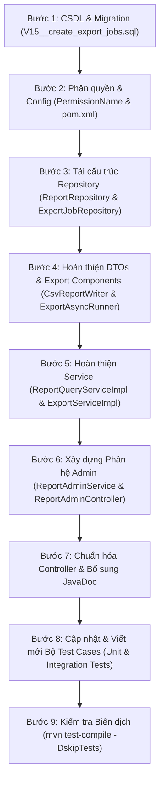

# Kế hoạch hoàn thiện module Report (Báo cáo & Thống kê tài chính)

## Bối cảnh & Hiện trạng

- Module `report` hiện đang bị loại trừ khỏi quá trình build dự án trong [pom.xml](file:///D:/projects/java/server/pom.xml) (`<exclude>com/datn/financeapp/module/report/**</exclude>` và `<testExclude>com/datn/financeapp/module/report/**</testExclude>`).
- **Nguyên nhân chính dẫn đến việc bị loại trừ:**
  1. **Lệch cấu trúc CSDL (`migration_v2`):**
     - Bảng `export_jobs` (lưu trữ tiến trình xuất báo cáo CSV) đã được thiết kế trong tài liệu kiến trúc [docs/bao-cao-thiet-ke-csdl.md](file:///D:/projects/java/server/docs/bao-cao-thiet-ke-csdl.md) (bảng số 21) nhưng chưa có file migration tương ứng trong thư mục `src/main/resources/db/migration_v2`.
     - Bảng `transactions` trong `V3`: cột ngày là `occurred_at TIMESTAMPTZ` (không phải `date`), loại giao dịch là enum chữ hoa `EXPENSE`, `INCOME`, `LOAN` (không phải `'expense'`, `'income'`, `'transfer'`), danh mục dùng `category_code VARCHAR(50)` (không phải `category_id`), không có cột `counts_in_report` hay `destination_wallet_id`.
     - Bảng `categories` trong `V2`: sử dụng cấu trúc cây phân cấp tự quản `parent_id`, `level`, `is_leaf`, `path` (`root_code/child_code`). Không tồn tại bảng `category_groups` hay cột `category_group_id` / `parent_category_id`.
     - Bảng `wallets` trong `V3`: cột số dư là `balance BIGINT` (không phải `current_balance`), không có cột `include_in_total`.
  2. **Lỗi biên dịch mã nguồn Java trong `module/report`:**
     - Các class không tồn tại trong project nhưng vẫn được gọi trong [ReportQueryServiceImpl.java](file:///D:/projects/java/server/src/main/java/com/datn/financeapp/module/report/service/impl/ReportQueryServiceImpl.java): `IconRefResponse`, `WalletRawBalanceResponse`, `CategoryRefResponse`.
     - Các phương thức không tồn tại trong `Transaction`: `t.getCategoryId()`, `t.getDate()`, `t.getDisplayName()`.
     - Các phương thức không tồn tại trong `WalletService`: `walletService.findRawBalance()`, `walletService.listWithRawBalance()`, `walletService.findRefById()`.
     - Các phương thức không tồn tại trong `CategoryService`: `categoryService.findRefById()`, `categoryService.findIconRef()`, `categoryService.findCategoryTree()`.
     - Cú pháp và tham số gọi trong [ExportAsyncRunner.java](file:///D:/projects/java/server/src/main/java/com/datn/financeapp/module/report/export/ExportAsyncRunner.java) bị lỗi tương tự.
  3. **Thiếu phân hệ Quản trị viên (Admin):**
     - Chưa có `ReportAdminController` và `ReportAdminService` để quản trị viên giám sát các tiến trình xuất báo cáo toàn hệ thống (`export_jobs`), dọn dẹp các job lỗi/kẹt, và xem báo cáo tổng hợp hệ thống.
     - Chưa có permission `Resource.REPORT` và `REPORT_READ`, `REPORT_DELETE` trong [PermissionName.java](file:///D:/projects/java/server/src/main/java/com/datn/financeapp/module/user/enums/PermissionName.java).
  4. **Các file test lỗi thời:**
     - [ReportSummaryIntegrationTest.java](file:///D:/projects/java/server/src/test/java/com/datn/financeapp/module/report/controller/ReportSummaryIntegrationTest.java) và [ExportJobIntegrationTest.java](file:///D:/projects/java/server/src/test/java/com/datn/financeapp/integrationTest/report/controller/ExportJobIntegrationTest.java) đang viết theo API/Schema cũ (`icon_id`, `category_group_id`, `category_id`), chưa cập nhật theo `migration_v2`.
     - Thư mục unit test `src/test/java/com/datn/financeapp/unitTest/report` còn trống.

---

## Các quyết định kiến trúc & Quy chuẩn thống nhất

### 1. Cơ sở dữ liệu (`migration_v2`)
- Tạo file migration: [src/main/resources/db/migration_v2/V15__create_export_jobs.sql](file:///D:/projects/java/server/src/main/resources/db/migration_v2/V15__create_export_jobs.sql).
- Cấu trúc bảng `export_jobs`:
  - `id UUID PRIMARY KEY DEFAULT gen_random_uuid()`
  - `user_id UUID NOT NULL REFERENCES users(id) ON DELETE CASCADE`
  - `format VARCHAR(10) NOT NULL` (ràng buộc `CHECK (format IN ('csv', 'pdf', 'excel'))`)
  - `status VARCHAR(20) NOT NULL DEFAULT 'processing'` (ràng buộc `CHECK (status IN ('processing', 'completed', 'failed'))`)
  - `file_path VARCHAR(255)`
  - `error_message TEXT`
  - `expires_at TIMESTAMPTZ`
  - `created_at TIMESTAMPTZ NOT NULL DEFAULT now()`
- Chỉ mục tối ưu:
  - `idx_export_user ON export_jobs (user_id, created_at DESC)`
  - `idx_export_cleanup ON export_jobs (status, expires_at) WHERE status = 'completed'`
  - `idx_export_stuck ON export_jobs (status, created_at) WHERE status = 'processing'`

### 2. Xử lý Múi giờ & Truy vấn Khoảng thời gian (`UserTimezoneHelper`)
- Giao dịch trong `transactions` lưu `occurred_at TIMESTAMPTZ` (UTC).
- Các API báo cáo nhận tham số ngày `LocalDate` (`fromDate`, `toDate`, hoặc tính từ `period`: `month`, `week`, `year`):
  - Sử dụng [UserTimezoneHelper](file:///D:/projects/java/server/src/main/java/com/datn/financeapp/module/budget/helper/UserTimezoneHelper.java) để đọc header `X-Timezone` của client (fallback `Asia/Ho_Chi_Minh`).
  - Quy đổi `fromDate` thành `startInstant = toStartInstant(fromDate, userZone)` (00:00:00 theo giờ địa phương).
  - Quy đổi `toDate` thành `endInstant = toEndInstant(toDate, userZone)` (23:59:59.999999999 theo giờ địa phương).
  - Câu truy vấn SQL sử dụng khoảng `t.occurred_at >= :startInstant AND t.occurred_at <= :endInstant` kết hợp `idx_txn_user_date` để đạt hiệu năng tối đa (Index Range Scan).
  - Với báo cáo theo ngày (`daily-trend`) và tháng (`monthly-trend`), chuyển đổi timezone trong SQL:
    - Ngày: `(t.occurred_at AT TIME ZONE :timeZone)::date AS day`
    - Tháng: `date_trunc('month', t.occurred_at AT TIME ZONE :timeZone)::date AS month`

### 3. Quy chuẩn Danh mục & Cây phân cấp
- Trong `migration_v2`:
  - Danh mục gốc (root categories): `level = 0`, `parent_id IS NULL`, `path = code`. Đây chính là các **Nhóm danh mục lớn** (`by-category-group`).
  - Danh mục con (leaf categories): `level > 0`, `parent_id` trỏ về cha, `path = parent_path || '/' || code`. Giao dịch chỉ được gán vào danh mục lá (`is_leaf = true`).
- Tìm nhóm danh mục gốc từ mã danh mục của giao dịch:
  - Dùng SQL: `root.code = split_part(c.path, '/', 1) AND root.level = 0`.
- API `GET /reports/by-category-group`:
  - Gom nhóm theo danh mục gốc (`level = 0`), tính tổng số tiền và tỷ trọng, kèm danh sách chi tiết các danh mục con bên trong nhóm đó.
- API `GET /reports/by-category`:
  - Khi `level = parent`: Gom nhóm theo danh mục gốc (`level = 0`), tính tổng tiền (cộng gộp tất cả danh mục con của nó), kèm danh sách `children_detail`.
  - Khi `level = sub`: Gom nhóm theo từng danh mục lá thực tế phát sinh giao dịch.

### 4. Quy chuẩn Giao dịch hợp lệ trong Báo cáo
- Bỏ qua giao dịch đã xóa mềm: `NOT t.is_deleted`.
- Loại giao dịch tính thu nhập: `t.type = 'INCOME'`.
- Loại giao dịch tính chi tiêu: `t.type = 'EXPENSE'`.
- Giao dịch cho vay (`t.type = 'LOAN'`) không tính vào thu/chi thông thường (hoặc xử lý riêng tùy theo tham số lọc).
- Lọc theo ví:
  - Nếu `walletId == null`: Xem báo cáo toàn bộ ví chưa xóa của người dùng.
  - Nếu `walletId != null`: Lọc chính xác `t.wallet_id = :walletId`.

### 5. Tích hợp dữ liệu Số dư Ví & Cảnh báo Ngân sách
- **Số dư tài chính (`balance`):**
  - Số dư cá nhân: `SELECT COALESCE(SUM(balance), 0) FROM wallets WHERE user_id = ? AND NOT is_deleted`.
  - Top 3 ví lớn nhất: Truy vấn từ `walletRepository.findAllByUserIdAndIsDeleted(userId, false, PageRequest.of(0, 3, Sort.by(Sort.Direction.DESC, "balance")))`.
- **Ngân sách cần chú ý (`budgets_needing_attention`):**
  - Tích hợp gọi `budgetOverviewService.alerts(userId)` trả về danh sách `BudgetAlertRes`.
  - Ánh xạ sang `ReportHomeResponse.BudgetAttentionItem` với `status = alert.status().code()`.

### 6. Phân hệ Quản trị viên (Admin)
- Thêm vào [PermissionName.java](file:///D:/projects/java/server/src/main/java/com/datn/financeapp/module/user/enums/PermissionName.java):
  - `Resource.REPORT("reports")`
  - `REPORT_READ(Resource.REPORT, Action.READ, "Xem danh sách và chi tiết tiến trình xuất báo cáo toàn hệ thống")`
  - `REPORT_DELETE(Resource.REPORT, Action.DELETE, "Hủy hoặc xóa tiến trình xuất báo cáo")`
- Xây dựng `ReportAdminController` tại `/reports/admin`:
  - `GET /reports/admin/export-jobs`: Xem danh sách tiến trình xuất báo cáo toàn hệ thống (hỗ trợ phân trang `Pageable`, filter theo `userId`, `status`, `format`).
  - `GET /reports/admin/export-jobs/{id}`: Xem chi tiết bất kỳ export job nào.
  - `DELETE /reports/admin/export-jobs/{id}`: Hủy/xóa job và xóa file vật lý trên đĩa.
  - `GET /reports/admin/summary`: Xem báo cáo tài chính tổng quan của bất kỳ user nào (`@RequestParam UUID user_id`).
- Xây dựng `ReportAdminService` & `ReportAdminServiceImpl`.

---

## Chi tiết các tệp sẽ tạo mới / chỉnh sửa

### 1. Cơ sở dữ liệu (Migration)
- **Tạo mới:** `src/main/resources/db/migration_v2/V15__create_export_jobs.sql`
  - Tạo bảng `export_jobs` với các ràng buộc CHECK và khóa ngoại `users(id)`.
  - Đánh index cho truy vấn theo user, dọn dẹp hết hạn và quét job bị kẹt.

### 2. Cấu hình & Phân quyền
- **Chỉnh sửa:** `pom.xml`
  - Bỏ `<exclude>com/datn/financeapp/module/report/**</exclude>` trong `<excludes>`.
  - Bỏ `<testExclude>com/datn/financeapp/module/report/**</testExclude>` trong `<testExcludes>`.
- **Chỉnh sửa:** `src/main/java/com/datn/financeapp/module/user/enums/PermissionName.java`
  - Bổ sung `Resource.REPORT("reports")`, quyền `REPORT_READ` và `REPORT_DELETE`.

### 3. Repository & SQL Query Fragments
- **Chỉnh sửa:** `src/main/java/com/datn/financeapp/module/report/repository/ReportQueryFragments.java`
  - Định nghĩa chuẩn `REPORT_ELIGIBLE = "NOT t.is_deleted AND t.type IN ('EXPENSE', 'INCOME')"`.
  - Định nghĩa chuẩn `WALLET_FILTER = "(:walletId IS NULL OR t.wallet_id = :walletId)"`.
- **Chỉnh sửa:** `src/main/java/com/datn/financeapp/module/report/repository/ReportRepository.java`
  - Viết lại toàn bộ Native Query:
    - `summary`: tính tổng `INCOME`, `EXPENSE`, số lượng giao dịch trong khoảng `[startInstant, endInstant]`.
    - `byCategoryGroup`: gom nhóm theo danh mục gốc (`root.level = 0`), dùng `split_part(c.path, '/', 1)`.
    - `byCategoryInGroup`: truy vấn danh mục con trong 1 nhóm gốc.
    - `byCategoryParentLevel`: gom nhóm theo danh mục cha gốc, đếm giao dịch, kiểm tra `has_children`.
    - `byCategoryChildLevel`: gom nhóm theo từng danh mục lá cụ thể.
    - `childrenDetail`: danh sách danh mục con chi tiết của 1 danh mục cha (kèm dòng giao dịch trực tiếp nếu có).
    - `dailyExpense`: chi tiêu theo từng ngày (quy đổi sang timezone user).
    - `monthlyTrend`: thu/chi theo từng tháng trong khoảng N tháng gần nhất.
    - `eligibleTransactions`: danh sách entity `Transaction` để hiển thị recent transactions và xuất CSV.
- **Chỉnh sửa:** `src/main/java/com/datn/financeapp/module/report/repository/ExportJobRepository.java`
  - Thêm phương thức tìm kiếm phân trang cho Admin: `findAllByUserIdAndStatus(UUID userId, String status, Pageable pageable)`.

### 4. DTOs & Mappers
- **Chỉnh sửa:** `src/main/java/com/datn/financeapp/module/report/dto/response/ReportHomeResponse.java`
  - Cập nhật record DTO cho `TopSpendingItem`, `RecentTransactionItem`, `IconRef` sử dụng chuỗi mã icon (`iconCode`) và mã màu (`color`) đồng bộ toàn dự án.
- **Chỉnh sửa:** `src/main/java/com/datn/financeapp/module/report/dto/response/CategoryBreakdownResponse.java`
  - Đồng bộ `IconRef` với `iconCode` và `pathData`.
- **Chỉnh sửa:** `src/main/java/com/datn/financeapp/module/report/dto/response/ExportJobResponse.java`
  - Đồng bộ format trả về `jobId`, `status`, `downloadUrl`, `expiresAt`, `errorMessage`.
- **Tạo mới:** `src/main/java/com/datn/financeapp/module/report/dto/request/ExportJobFilterRequest.java`
  - DTO lọc cho Admin (`userId`, `status`, `format`).

### 5. Services & Business Logic
- **Chỉnh sửa:** `src/main/java/com/datn/financeapp/module/report/service/impl/ReportQueryServiceImpl.java`
  - Tích hợp `UserTimezoneHelper` để quy đổi `LocalDate` sang UTC `Instant` chính xác.
  - Sửa logic lấy số dư tổng: dùng `walletRepository` và native SQL `balance`.
  - Sửa logic `topWallets`: lấy top 3 ví có `balance` lớn nhất từ `walletRepository`.
  - Thay thế toàn bộ mã tham chiếu không tồn tại (`IconRefResponse`, `WalletRawBalanceResponse`, `CategoryRefResponse`) bằng `BudgetCategoryHelper`, `CategoryRepository`, `IconService`, `WalletService`.
  - Sửa logic `recentTransactions`: lấy từ `Transaction` entity chuẩn (`getOccurredAt()`, `getCategoryCode()`, `getName()`, `getAmount()`).
- **Chỉnh sửa:** `src/main/java/com/datn/financeapp/module/report/export/ExportAsyncRunner.java`
  - Sửa phương thức `toRow()` ánh xạ `Transaction` chuẩn (`category_code`, `occurred_at`, `name`).
  - Format ngày theo timezone của user.
- **Chỉnh sửa:** `src/main/java/com/datn/financeapp/module/report/export/CsvReportWriter.java`
  - Chuẩn hóa xuất CSV RFC 4180 với UTF-8 BOM, đảm bảo hiển thị đúng tiếng Việt trong Microsoft Excel.
- **Tạo mới:** `src/main/java/com/datn/financeapp/module/report/service/ReportAdminService.java` & `src/main/java/com/datn/financeapp/module/report/service/impl/ReportAdminServiceImpl.java`
  - Cung cấp các hàm: `searchJobs(ExportJobFilterRequest filter, Pageable pageable)`, `getJobDetail(UUID jobId)`, `deleteJob(UUID jobId)`, `getUserSummary(UUID targetUserId, String period, LocalDate fromDate, LocalDate toDate, UUID walletId)`.

### 6. Controllers
- **Chỉnh sửa:** `src/main/java/com/datn/financeapp/module/report/controller/ReportController.java`
  - Giữ nguyên toàn bộ 9 RESTful endpoints dành cho User.
  - Bổ sung JavaDoc chi tiết bằng tiếng Việt, validate `@Valid` và xử lý param `wallet_id`.
- **Tạo mới:** `src/main/java/com/datn/financeapp/module/report/controller/ReportAdminController.java`
  - Đặt tại prefix `/reports/admin`.
  - Bảo vệ bằng `@PreAuthorize("hasAuthority('reports:read') or hasAnyAuthority('ROLE_ADMIN', 'ADMIN')")`.
  - Endpoint quản lý `export-jobs` và báo cáo user.

### 7. Unit Tests & Integration Tests
- **Chỉnh sửa:** `src/test/java/com/datn/financeapp/module/report/controller/ReportSummaryIntegrationTest.java`
  - Cập nhật toàn bộ helper: tạo danh mục bằng `CategoryCreateReq` (`code`, `name`, `iconCode`, `color`), tạo giao dịch bằng `category_code` và ví hợp lệ theo `migration_v2`.
- **Chỉnh sửa:** `src/test/java/com/datn/financeapp/integrationTest/report/controller/ExportJobIntegrationTest.java`
  - Cập nhật test data theo `category_code`.
- **Chỉnh sửa:** `src/test/java/com/datn/financeapp/integrationTest/report/repository/ExportJobRepositoryTest.java`
  - Đảm bảo tương thích hoàn toàn với entity `ExportJob` và CSDL.
- **Tạo mới Unit Tests:**
  - `src/test/java/com/datn/financeapp/module/report/service/impl/ReportQueryServiceImplTest.java`: Kiểm thử mock các logic tính toán tỷ lệ, trend ngày/tháng, so sánh kỳ trước.
  - `src/test/java/com/datn/financeapp/module/report/service/impl/ExportServiceImplTest.java`: Kiểm thử tạo job, kiểm tra định dạng CSV, chặn PDF/Excel với lỗi 501.
  - `src/test/java/com/datn/financeapp/module/report/service/impl/ReportAdminServiceImplTest.java`: Kiểm thử tìm kiếm, xem chi tiết và xóa job của Admin.

---

## Kế hoạch thực hiện từng bước

- **Giai đoạn 1: Chuẩn bị CSDL & Cấu hình**
  - Viết `V15__create_export_jobs.sql`.
  - Cập nhật `PermissionName.java` (thêm `REPORT_READ`, `REPORT_DELETE`).
  - Mở exclude trong `pom.xml`.

- **Giai đoạn 2: Cốt lõi Repository & Service**
  - Viết lại các câu truy vấn native SQL trong `ReportRepository.java` chuẩn theo bảng `transactions`, `categories`, múi giờ và cấu trúc `migration_v2`.
  - Chỉnh sửa `ExportJobRepository.java`.
  - Viết lại `ReportQueryServiceImpl.java` xử lý chuẩn xác toàn bộ 6 nhóm báo cáo (`home`, `summary`, `byCategoryGroup`, `byCategory`, `dailyTrend`, `monthlyTrend`).
  - Sửa `ExportServiceImpl.java`, `ExportAsyncRunner.java`, `CsvReportWriter.java`.

- **Giai đoạn 3: Phân hệ Admin & Controller**
  - Viết `ReportAdminService` / `ReportAdminServiceImpl`.
  - Viết `ReportAdminController` với bảo vệ phân quyền Spring Security.
  - Rà soát `ReportController` đảm bảo chuẩn RESTful API, Idempotency và mã HTTP response.

- **Giai đoạn 4: Kiểm thử & Nghiệm thu**
  - Cập nhật các integration test cũ theo đúng schema mới.
  - Viết bộ unit tests cho các service.
  - Chạy `mvn test-compile -DskipTests` đảm bảo `BUILD SUCCESS` 100%.
