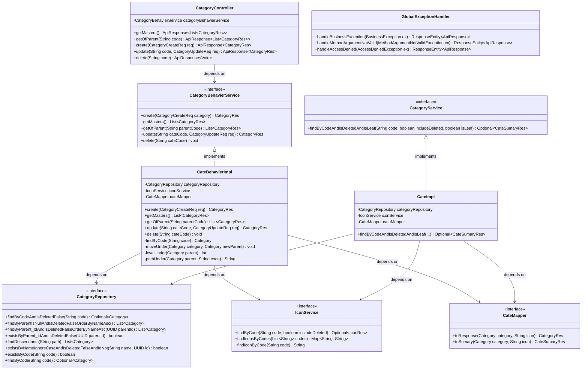
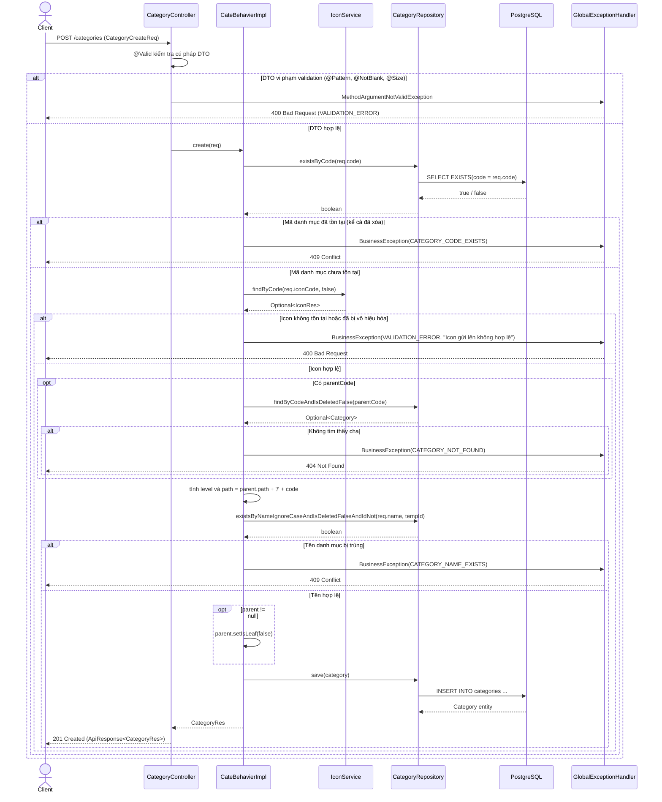
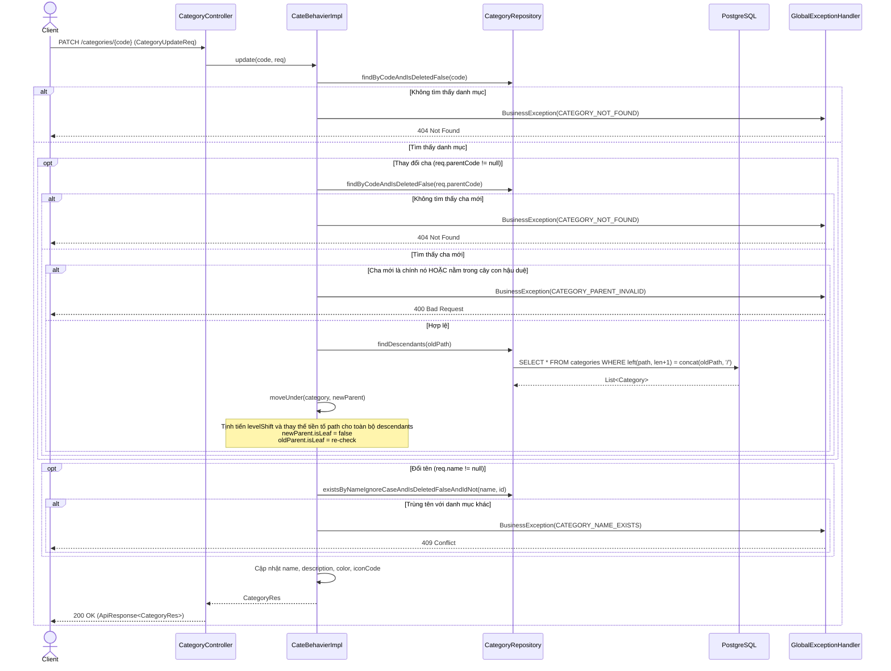
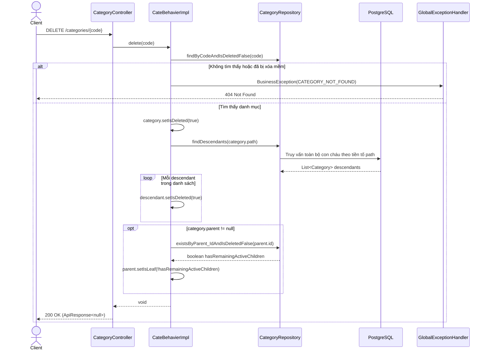

# ĐẶC TẢ RESTFUL API ENDPOINTS — DANH MỤC THU CHI (CATEGORY)

> **File này trả lời:** Danh sách và đặc tả kỹ thuật chi tiết các RESTful API endpoints thuộc phân hệ Cây Danh Mục Thu Chi (`/categories`), cấu trúc Request/Response DTO, cơ chế phân quyền RBAC, kiểm tra tính toàn vẹn cây phân cấp, và các mã lỗi trả về.  
> Cấu trúc bảng & Entity → [Lớp thực thể](#4-cau-truc-thuc-the-va-dto) · Luồng xử lý chi tiết → [docs/work_flow/category.md](../work_flow/category.md) · Quy tắc RBAC → [docs/role_per.md](../role_per.md)

---

## 📑 MỤC LỤC

- [1. Quy ước chung](#1-quy-uoc-chung)
- [2. Danh mục Endpoint Tổng hợp](#2-danh-muc-endpoint)
- [3. Đặc tả Chi tiết Endpoints](#3-dac-ta-chi-tiet-endpoints)
  - [3.1 Lấy danh sách danh mục gốc (`GET /categories`)](#31-lay-danh-sach-goc)
  - [3.2 Lấy danh sách danh mục con (`GET /categories/{code}/children`)](#32-lay-danh-sach-con)
  - [3.3 Tạo danh mục mới (`POST /categories`)](#33-tao-danh-muc)
  - [3.4 Cập nhật danh mục & Di chuyển cây (`PATCH /categories/{code}`)](#34-cap-nhat-danh-muc)
  - [3.5 Xóa mềm danh mục (`DELETE /categories/{code}`)](#35-xoa-danh-muc)
- [4. Cấu trúc Thực thể JPA và DTO](#4-cau-truc-thuc-the-va-dto)
  - [4.1 Thực thể JPA (`Category`)](#41-thuc-the-jpa)
  - [4.2 DTOs Yêu cầu (Request)](#42-dtos-yeu-cau)
  - [4.3 DTOs Phản hồi (Response)](#43-dtos-phan-hoi)
- [5. Biểu đồ Lớp Phân tầng (Spring Boot Class Diagram)](#5-bieu-do-lop-phan-tang)
- [6. Biểu đồ Tuần tự (Sequence Diagrams)](#6-bieu-do-tuan-tu)
  - [6.1 Luồng Tạo danh mục mới (`POST /categories`)](#61-sequence-create)
  - [6.2 Luồng Cập nhật & Di chuyển cây (`PATCH /categories/{code}`)](#62-sequence-update)
  - [6.3 Luồng Xóa mềm cascade (`DELETE /categories/{code}`)](#63-sequence-delete)
- [7. Bảng Ma trận Mã lỗi (Error Code Matrix)](#7-bang-ma-tran-ma-loi)
- [8. Kịch bản Kiểm thử REST API (Spring Boot Test Cases)](#8-kich-ban-kiem-thu-rest-api)

---

## 1. Quy ước chung <a id="1-quy-uoc-chung"></a>

- **Base URL:** `/categories`
- **Định dạng dữ liệu:** `Content-Type: application/json`, `Accept: application/json`.
- **Quy ước đặt tên thuộc tính JSON:** Cấu hình chuẩn `snake_case` toàn dự án (`spring.jackson.property-naming-strategy: SNAKE_CASE`).
- **Đóng gói chuẩn:** Mọi response thành công hoặc thất bại đều được bọc trong `ApiResponse<T>`:
  ```json
  {
    "success": true,
    "code": 200,
    "message": "Thành công",
    "data": { ... }
  }
  ```
- **Xác thực phiên:** Mọi endpoint đều yêu cầu token xác thực hợp lệ qua HTTP Header:
  `Authorization: Bearer <accessToken>`.
- **Cơ chế phân quyền RBAC:**
  - **Đọc (`GET`):** Người dùng đã đăng nhập hợp lệ trong hệ thống đều có thể tra cứu cây danh mục dùng chung.
  - **Ghi (Tạo/Sửa - `POST`, `PATCH`):** Được bảo vệ bằng `@PreAuthorize("hasAuthority(T(com.datn.financeapp.module.user.enums.PermissionName).CATEGORIES_UPDATE.getValue())")` (yêu cầu quyền `categories:update`).
  - **Xóa (`DELETE`):** Được bảo vệ bằng `@PreAuthorize("hasAuthority(T(com.datn.financeapp.module.user.enums.PermissionName).CATEGORIES_DELETE.getValue())")` (yêu cầu quyền `categories:delete`).
- **Idempotency:** Endpoint `POST /categories` kích hoạt `@Idempotent` chống trùng lặp request khi bấm nhiều lần liên tiếp.

---

## 2. Danh mục Endpoint Tổng hợp <a id="2-danh-muc-endpoint"></a>

| Phương thức | Endpoint | Quyền hạn yêu cầu | Idempotent | Mô tả |
| :--- | :--- | :--- | :---: | :--- |
| **`GET`** | `/categories` | Đã đăng nhập | Không | Lấy danh sách toàn bộ danh mục gốc (level 0) chưa xóa, sắp xếp theo tên A-Z |
| **`GET`** | `/categories/{code}/children` | Đã đăng nhập | Không | Lấy danh sách danh mục con trực tiếp của một danh mục cha, sắp xếp theo tên A-Z |
| **`POST`** | `/categories` | `categories:update` | **Có** | Tạo mới danh mục (gốc hoặc con). Tự động cập nhật `level`, `path` và trạng thái `is_leaf` của cha |
| **`PATCH`** | `/categories/{code}` | `categories:update` | Không | Cập nhật thông tin danh mục, hoặc di chuyển sang danh mục cha khác (tịnh tiến toàn bộ cây con hậu duệ) |
| **`DELETE`** | `/categories/{code}` | `categories:delete` | Không | Xóa mềm danh mục và cascade xóa mềm toàn bộ cây con cháu (`descendants`); cập nhật lại `is_leaf` của cha |

---

## 3. Đặc tả Chi tiết Endpoints <a id="3-dac-ta-chi-tiet-endpoints"></a>

### 3.1 Lấy danh sách danh mục gốc (`GET /categories`) <a id="31-lay-danh-sach-goc"></a>

Tra cứu tất cả các danh mục cấp cao nhất (gốc, `level = 0`, `parent_id IS NULL`) chưa bị xóa mềm trong hệ thống.

- **Method / Path:** `GET /categories`
- **Headers:** `Authorization: Bearer <accessToken>`
- **Response Headers:** `Content-Type: application/json`
- **Response Status:** `200 OK`
- **Response Body:** `ApiResponse<List<CategoryRes>>`

```json
{
  "success": true,
  "code": 200,
  "message": "Thành công",
  "data": [
    {
      "name": "Ăn uống",
      "code": "an_uong",
      "description": "Chi tiêu ăn uống hàng ngày",
      "parent_code": null,
      "icon": "M8 3v7a2 2 0 002 2v9M16 3c-1.4 1.2-2 2.6-2 4.4 0 1.6.6 3 2 4.1v9",
      "color": "#3d6b7d",
      "level": 0,
      "is_leaf": false,
      "created_at": "2026-09-01T08:00:00Z"
    },
    {
      "name": "Đi lại",
      "code": "di_lai",
      "description": "Phương tiện di chuyển, xăng dầu, gửi xe",
      "parent_code": null,
      "icon": "M5 17a2.5 2.5 0 100-5 2.5 2.5 0 000 5zM19 17a2.5 2.5 0 100-5 2.5 2.5 0 000 5zM7 14.5h6l3-5h3",
      "color": "#4a6f5c",
      "level": 0,
      "is_leaf": false,
      "created_at": "2026-09-01T08:00:00Z"
    }
  ]
}
```

---

### 3.2 Lấy danh sách danh mục con (`GET /categories/{code}/children`) <a id="32-lay-danh-sach-con"></a>

Tra cứu danh sách các danh mục con trực tiếp (chưa xóa mềm) của một danh mục cha xác định bằng `code`.

- **Method / Path:** `GET /categories/{code}/children`
- **Path Variables:**
  - `code` (String, required): Mã định danh duy nhất của danh mục cha (ví dụ `an_uong`).
- **Headers:** `Authorization: Bearer <accessToken>`
- **Response Status:** `200 OK`
- **Response Body:** `ApiResponse<List<CategoryRes>>`

```json
{
  "success": true,
  "code": 200,
  "message": "Thành công",
  "data": [
    {
      "name": "Ăn sáng",
      "code": "an_sang",
      "description": "Bữa sáng",
      "parent_code": "an_uong",
      "icon": "M4 12a8 4 0 0116 0v4a2 2 0 01-2 2H6a2 2 0 01-2-2z",
      "color": "#3d6b7d",
      "level": 1,
      "is_leaf": true,
      "created_at": "2026-09-01T08:00:00Z"
    },
    {
      "name": "Cà phê",
      "code": "ca_phe",
      "description": "Cà phê và đồ uống",
      "parent_code": "an_uong",
      "icon": "M6 8h12v6a4 4 0 01-4 4h-4a4 4 0 01-4-4zM18 10h2a2 2 0 010 4h-2",
      "color": "#3d6b7d",
      "level": 1,
      "is_leaf": true,
      "created_at": "2026-09-01T08:00:00Z"
    }
  ]
}
```

- **Mã lỗi có thể gặp:**
  - `404 Not Found`: Mã danh mục cha không tồn tại hoặc đã bị xóa mềm (`CATEGORY_NOT_FOUND`).

---

### 3.3 Tạo danh mục mới (`POST /categories`) <a id="33-tao-danh-muc"></a>

Tạo mới một danh mục thu/chi. Nếu `parent_code` là `null`, danh mục sẽ được xếp làm danh mục gốc (`level = 0`, `path = code`). Nếu có `parent_code`, danh mục được gắn làm con của cha tương ứng (`level = parent.level + 1`, `path = parent.path + "/" + code`), và danh mục cha tự động chuyển trạng thái `is_leaf = false`.

- **Method / Path:** `POST /categories`
- **Quyền hạn:** `categories:update`
- **Idempotency:** Hỗ trợ Header `Idempotency-Key: <UUID>`
- **Request Body (`CategoryCreateReq`):**

| Trường | Kiểu | Bắt buộc | Ràng buộc validation | Mô tả |
| :--- | :--- | :---: | :--- | :--- |
| `name` | String | Có | `@NotBlank`, `@Size(max = 50)` | Tên hiển thị danh mục |
| `code` | String | Có | `@NotBlank`, `@Size(max = 50)`, `@Pattern(^[a-z0-9_]+$)` | Mã định danh duy nhất toàn hệ thống, chữ thường, số, dấu gạch dưới |
| `description` | String | Có | `@NotBlank` | Mô tả công dụng danh mục |
| `icon_code` | String | Không | Tồn tại và còn hoạt động trong kho `icons` | Mã biểu tượng SVG liên kết |
| `color` | String | Không | `@Pattern(^#[0-9A-Fa-f]{6}$)` | Mã màu hiển thị dạng Hex `#RRGGBB` |
| `parent_code` | String | Không | Phải tồn tại và chưa bị xóa | Mã danh mục cha (`null` nếu là danh mục gốc) |

**Request Body mẫu:**
```json
{
  "name": "Trà sữa",
  "code": "tra_sua",
  "description": "Các loại trà sữa, sinh tố",
  "icon_code": "ca_phe",
  "color": "#3d6b7d",
  "parent_code": "an_uong"
}
```

- **Response Status:** `201 Created`
- **Response Body (`ApiResponse<CategoryRes>`):**
```json
{
  "success": true,
  "code": 201,
  "message": "Thành công",
  "data": {
    "name": "Trà sữa",
    "code": "tra_sua",
    "description": "Các loại trà sữa, sinh tố",
    "parent_code": "an_uong",
    "icon": "M6 8h12v6a4 4 0 01-4 4h-4a4 4 0 01-4-4zM18 10h2a2 2 0 010 4h-2",
    "color": "#3d6b7d",
    "level": 1,
    "is_leaf": true,
    "created_at": "2026-10-19T20:45:00Z"
  }
}
```

- **Mã lỗi có thể gặp:**
  - `400 Bad Request`:
    - Vi phạm validation format (`VALIDATION_ERROR`): mã chứa ký tự in hoa/khoảng trắng, mã màu sai `#RRGGBB`, bỏ trống trường bắt buộc.
    - Icon gửi lên không tồn tại hoặc đã bị vô hiệu hóa (`VALIDATION_ERROR`, "Icon gửi lên không hợp lệ").
  - `403 Forbidden`: Người dùng không có quyền `categories:update`.
  - `404 Not Found`: `parent_code` chỉ định không tồn tại hoặc đã bị xóa mềm (`CATEGORY_NOT_FOUND`).
  - `409 Conflict`:
    - Mã danh mục đã tồn tại trong hệ thống kể cả danh mục đã xóa (`CATEGORY_CODE_EXISTS`).
    - Tên danh mục trùng với một danh mục khác đang hoạt động, không phân biệt hoa thường (`CATEGORY_NAME_EXISTS`).

---

### 3.4 Cập nhật danh mục & Di chuyển cây (`PATCH /categories/{code}`) <a id="34-cap-nhat-danh-muc"></a>

Cập nhật thông tin chi tiết của danh mục hoặc di chuyển danh mục sang danh mục cha mới. Khi di chuyển sang cha mới, toàn bộ cây con hậu duệ (`descendants`) sẽ tự động được tịnh tiến lại cấp bậc (`level`) và chuỗi tiền tố đường dẫn (`path`). Trạng thái nút lá (`is_leaf`) của cả cha cũ và cha mới đều được tự động tính toán lại.

- **Method / Path:** `PATCH /categories/{code}`
- **Path Variables:** `code` (String, required) — Mã định danh danh mục cần sửa.
- **Quyền hạn:** `categories:update`
- **Request Body (`CategoryUpdateReq`):**

| Trường | Kiểu | Bắt buộc | Ràng buộc validation | Mô tả |
| :--- | :--- | :---: | :--- | :--- |
| `name` | String | Không | `@Size(max = 50)` | Tên mới danh mục (nếu có, không được trùng với danh mục khác) |
| `description` | String | Không | Chuỗi mô tả mới | Cập nhật mô tả |
| `icon_code` | String | Không | Tồn tại và còn hoạt động trong kho `icons` | Biểu tượng mới |
| `color` | String | Không | `@Pattern(^#[0-9A-Fa-f]{6}$)` | Mã màu mới `#RRGGBB` |
| `parent_code` | String | Có | `@NotBlank` | Mã danh mục cha (giữ nguyên nếu không đổi cha, không hỗ trợ chuyển thành danh mục gốc) |

**Request Body mẫu:**
```json
{
  "name": "Trà sữa & Đồ uống",
  "description": "Trà sữa, trà trái cây và sinh tố đóng chai",
  "icon_code": "ca_phe",
  "color": "#3d6b7d",
  "parent_code": "an_uong"
}
```

- **Response Status:** `200 OK`
- **Response Body (`ApiResponse<CategoryRes>`):**
```json
{
  "success": true,
  "code": 200,
  "message": "Thành công",
  "data": {
    "name": "Trà sữa & Đồ uống",
    "code": "tra_sua",
    "description": "Trà sữa, trà trái cây và sinh tố đóng chai",
    "parent_code": "an_uong",
    "icon": "M6 8h12v6a4 4 0 01-4 4h-4a4 4 0 01-4-4zM18 10h2a2 2 0 010 4h-2",
    "color": "#3d6b7d",
    "level": 1,
    "is_leaf": true,
    "created_at": "2026-10-19T20:45:00Z"
  }
}
```

- **Mã lỗi có thể gặp:**
  - `400 Bad Request`:
    - Vi phạm validation format (`VALIDATION_ERROR`).
    - Chọn danh mục cha mới là chính nó hoặc là một danh mục con cháu nằm trong cây của chính nó (`CATEGORY_PARENT_INVALID`, ngăn ngừa vòng lặp chu trình).
  - `403 Forbidden`: Người dùng không có quyền `categories:update`.
  - `404 Not Found`: Danh mục cần sửa hoặc danh mục cha mới không tồn tại (`CATEGORY_NOT_FOUND`).
  - `409 Conflict`: Tên mới trùng với một danh mục khác đang hoạt động (`CATEGORY_NAME_EXISTS`).

---

### 3.5 Xóa mềm danh mục (`DELETE /categories/{code}`) <a id="35-xoa-danh-muc"></a>

Thực hiện xóa mềm (`is_deleted = true`) danh mục và đồng thời **cascade xóa mềm toàn bộ cây con cháu hậu duệ**. Sau khi xóa, nếu danh mục cha cũ không còn bất kỳ danh mục con nào đang hoạt động thì cha cũ sẽ tự động trở lại thành nút lá (`is_leaf = true`).

- **Method / Path:** `DELETE /categories/{code}`
- **Path Variables:** `code` (String, required) — Mã danh mục cần xóa.
- **Quyền hạn:** `categories:delete`
- **Response Status:** `200 OK`
- **Response Body:** `ApiResponse<Void>`

```json
{
  "success": true,
  "code": 200,
  "message": "Thành công",
  "data": null
}
```

- **Mã lỗi có thể gặp:**
  - `403 Forbidden`: Người dùng không có quyền `categories:delete`.
  - `404 Not Found`: Mã danh mục không tồn tại hoặc đã bị xóa mềm trước đó (`CATEGORY_NOT_FOUND`).

---

## 4. Cấu trúc Thực thể JPA và DTO <a id="4-cau-truc-thuc-the-va-dto"></a>

### 4.1 Thực thể JPA (`Category`) <a id="41-thuc-the-jpa"></a>

Ánh xạ trực tiếp với bảng `categories` trong CSDL:

```java
@Entity
@Table(name = "categories")
@Getter
@Setter
@Builder
@NoArgsConstructor
@AllArgsConstructor
public class Category extends AssignedIdEntity {

    @Id
    @NotNull
    private UUID id;

    @Size(max = 50)
    @NotNull
    @Column(name = "name", nullable = false, length = 50)
    private String name;

    @Size(max = 50)
    @Column(name = "code", unique = true, nullable = false, length = 50)
    private String code;

    @Column(name = "description")
    private String description;

    @ManyToOne(fetch = FetchType.LAZY)
    @JoinColumn(name = "parent_id")
    private Category parent;

    @NotNull
    @Column(name = "icon_code")
    private String iconCode;

    @NotNull
    @Size(min = 7, max = 7)
    @Column(name = "color", nullable = false, length = 7) // #RRGGBB
    private String color;

    @NotNull
    @Column(name = "level", nullable = false)
    @Builder.Default
    private Integer level = 0;

    @NotNull
    @Column(name = "is_leaf", nullable = false)
    @Builder.Default
    private Boolean isLeaf = true;

    @NotNull
    @Size(max = 255)
    @Column(name = "path", nullable = false)
    private String path;

    // Kế thừa từ AssignedIdEntity: isDeleted, createdAt, updatedAt
}
```

### 4.2 DTOs Yêu cầu (Request) <a id="42-dtos-yeu-cau"></a>

#### `CategoryCreateReq`
```java
public record CategoryCreateReq(
    @NotBlank(message = "Tên danh mục không được để trống.")
    @Size(max = 50, message = "Tên danh mục không được vượt quá 50 ký tự.")
    String name,

    @NotBlank(message = "Mã danh mục không được để trống.")
    @Size(max = 50, message = "Mã danh mục không được vượt quá 50 ký tự.")
    @Pattern(regexp = "^[a-z0-9_]+$", message = "Mã chỉ gồm chữ thường, số và dấu gạch dưới.")
    String code,

    @NotBlank(message = "Mô tả không được để trống.")
    String description,

    String iconCode,

    @Pattern(regexp = "^#[0-9A-Fa-f]{6}$", message = "Mã màu phải có dạng #RRGGBB.")
    String color,

    String parentCode
) {}
```

#### `CategoryUpdateReq`
```java
public record CategoryUpdateReq(
    @Size(max = 50, message = "Tên danh mục không được vượt quá 50 ký tự.")
    String name,

    String description,

    String iconCode,

    @Pattern(regexp = "^#[0-9A-Fa-f]{6}$", message = "Mã màu phải có dạng #RRGGBB.")
    String color,

    @NotBlank(message = "Mã danh mục cha không được để trống.")
    String parentCode
) {}
```

### 4.3 DTOs Phản hồi (Response) <a id="43-dtos-phan-hoi"></a>

#### `CategoryRes`
```java
public record CategoryRes(
    @JsonIgnore UUID id,
    String name,
    String code,
    String description,
    String parentCode,
    String icon,          // Chuỗi SVG path_data lấy từ kho icons
    String color,
    Integer level,
    Boolean isLeaf,
    Instant createdAt,
    @JsonIgnore Boolean isDeleted
) {}
```

#### `CateSumaryRes` (Dùng cho module khác gọi nội bộ qua `CategoryService`)
```java
public record CateSumaryRes(
    @JsonIgnore UUID id,
    String name,
    String code,
    String icon,
    String color
) {}
```

---

## 5. Biểu đồ Lớp Phân tầng (Spring Boot Class Diagram) <a id="5-bieu-do-lop-phan-tang"></a>



---

## 6. Biểu đồ Tuần tự (Sequence Diagrams) <a id="6-bieu-do-tuan-tu"></a>

### 6.1 Luồng Tạo danh mục mới (`POST /categories`) <a id="61-sequence-create"></a>



---

### 6.2 Luồng Cập nhật & Di chuyển cây (`PATCH /categories/{code}`) <a id="62-sequence-update"></a>



---

### 6.3 Luồng Xóa mềm cascade (`DELETE /categories/{code}`) <a id="63-sequence-delete"></a>



---

## 7. Bảng Ma trận Mã lỗi (Error Code Matrix) <a id="7-bang-ma-tran-ma-loi"></a>

| ErrorCode Enum | HTTP Status | Thông báo mặc định | Điều kiện phát sinh |
| :--- | :--- | :--- | :--- |
| `VALIDATION_ERROR` | `400 Bad Request` | Dữ liệu gửi lên không hợp lệ. | Cú pháp request sai định dạng, `code` sai regex, mã màu sai `#RRGGBB`, hoặc `icon_code` không tồn tại trong kho |
| `CATEGORY_PARENT_INVALID` | `400 Bad Request` | Danh mục cha không hợp lệ. | Khi sửa danh mục (`PATCH`), gán cha mới là chính nó hoặc là một danh mục con cháu nằm trong cây của nó (gây chu trình lặp) |
| `FORBIDDEN` | `403 Forbidden` | Bạn không có quyền thực hiện thao tác này. | Không có quyền `categories:update` khi tạo/sửa hoặc không có quyền `categories:delete` khi xóa |
| `CATEGORY_NOT_FOUND` | `404 Not Found` | Không tìm thấy danh mục. | `code` không tồn tại trong hệ thống, hoặc danh mục đã bị đánh dấu `is_deleted = true` |
| `CATEGORY_CODE_EXISTS` | `409 Conflict` | Mã danh mục đã tồn tại. | `code` đã được sử dụng trong bảng `categories` (kể cả bản ghi đã xóa mềm vì `code` giữ chỗ vĩnh viễn) |
| `CATEGORY_NAME_EXISTS` | `409 Conflict` | Đã có danh mục cùng tên ở cấp này. | Tên danh mục bị trùng lặp với danh mục khác đang hoạt động trên toàn cây (không phân biệt chữ hoa/thường) |
| `TRANSACTION_CATEGORY_NOT_LEAF` | `400 Bad Request` | Giao dịch chỉ được gắn vào danh mục lá. | Do trigger CSDL `trg_transactions_category_leaf` kích hoạt khi tạo giao dịch nhưng gắn vào danh mục còn có con (`is_leaf = false`) |

---

## 8. Kịch bản Kiểm thử REST API (Spring Boot Test Cases) <a id="8-kich-ban-kiem-thu-rest-api"></a>

| Mã Test Case | Nhóm kiểm thử | Mục đích kiểm thử | Đầu vào HTTP Request | Tiền điều kiện / Mock CSDL | Kết quả kỳ vọng (Expected Output) |
| :--- | :--- | :--- | :--- | :--- | :--- |
| **TC_CAT_01** | **Query Masters** | Lấy danh sách danh mục gốc thành công | `GET /categories`<br>Token: User/Admin hợp lệ | Đã seed 18 danh mục gốc chưa xóa | - **Status**: `200 OK`<br>- **Body**: `success: true`, mảng danh mục gốc, `parent_code: null`, không lộ trường `id` |
| **TC_CAT_02** | **Query Children** | Lấy danh mục con trực tiếp thành công | `GET /categories/an_uong/children`<br>Token hợp lệ | Danh mục `an_uong` có các con `an_sang`, `ca_phe` | - **Status**: `200 OK`<br>- **Body**: Mảng các con có `parent_code: "an_uong"`, `level: 1` |
| **TC_CAT_03** | **Query Children** | Tra cứu con của mã cha không tồn tại | `GET /categories/ma_khong_ton_tai/children` | Không có mã này trong CSDL | - **Status**: `404 Not Found`<br>- **Body**: `CATEGORY_NOT_FOUND` |
| **TC_CAT_04** | **Create Root** | Tạo thành công danh mục gốc mới | `POST /categories`<br>Token quyền `categories:update`<br>Body: `{"name":"Từ thiện","code":"tu_thien","description":"Mô tả","icon_code":"qua_tang","color":"#3d6b7d","parent_code":null}` | `tu_thien` chưa từng tồn tại, icon `qua_tang` active | - **Status**: `201 Created`<br>- **Body**: `level: 0`, `is_leaf: true`, `path: "tu_thien"`, `parent_code: null` |
| **TC_CAT_05** | **Create Child** | Tạo thành công danh mục con | `POST /categories`<br>Token quyền `categories:update`<br>Body: `{"name":"Trà sữa","code":"tra_sua","description":"Mô tả","icon_code":"ca_phe","color":"#3d6b7d","parent_code":"an_uong"}` | `an_uong` đang tồn tại, `tra_sua` chưa có | - **Status**: `201 Created`<br>- **Body**: `level: 1`, `path: "an_uong/tra_sua"`, `parent_code: "an_uong"`. Cha `an_uong` chuyển `is_leaf: false` |
| **TC_CAT_06** | **Validation** | Báo lỗi khi mã `code` sai quy cách ký tự | `POST /categories`<br>Body: `{"name":"Test","code":"Tra Sua 123","description":"Mô tả"}` | Không quan trọng | - **Status**: `400 Bad Request`<br>- **Body**: `VALIDATION_ERROR`, thông báo định dạng mã |
| **TC_CAT_07** | **Validation** | Báo lỗi khi mã màu sai định dạng Hex | `POST /categories`<br>Body: `{"name":"Test","code":"test_code","color":"#ZZ1122"}` | Không quan trọng | - **Status**: `400 Bad Request`<br>- **Body**: `VALIDATION_ERROR`, thông báo định dạng màu |
| **TC_CAT_08** | **Validation** | Báo lỗi khi icon không tồn tại | `POST /categories`<br>Body: `{"name":"Test","code":"test_code","description":"Mô tả","icon_code":"icon_rac"}` | Kho `icons` không có `icon_rac` | - **Status**: `400 Bad Request`<br>- **Body**: `VALIDATION_ERROR`, "Icon gửi lên không hợp lệ" |
| **TC_CAT_09** | **Conflict** | Báo lỗi khi mã `code` đã tồn tại (kể cả đã xóa) | `POST /categories`<br>Body: `{"name":"Khác","code":"an_uong","description":"Mô tả"}` | Mã `an_uong` đã có trong CSDL | - **Status**: `409 Conflict`<br>- **Body**: `CATEGORY_CODE_EXISTS` |
| **TC_CAT_10** | **Conflict** | Báo lỗi khi tên bị trùng không phân biệt hoa/thường | `POST /categories`<br>Body: `{"name":"ĂN UỐNG","code":"an_uong_moi","description":"Mô tả"}` | Đã có danh mục tên "Ăn uống" | - **Status**: `409 Conflict`<br>- **Body**: `CATEGORY_NAME_EXISTS` |
| **TC_CAT_11** | **RBAC** | Từ chối tạo danh mục khi user thiếu quyền | `POST /categories`<br>Token User thường (không có `categories:update`) | User thường | - **Status**: `403 Forbidden`<br>- **Body**: `FORBIDDEN` |
| **TC_CAT_12** | **Update Info** | Sửa thông tin mô tả, màu sắc danh mục | `PATCH /categories/an_sang`<br>Token quyền `categories:update`<br>Body: `{"description":"Mô tả mới","color":"#112233","parent_code":"an_uong"}` | `an_sang` đang tồn tại | - **Status**: `200 OK`<br>- **Body**: Dữ liệu cập nhật màu và mô tả mới |
| **TC_CAT_13** | **Move Tree** | Di chuyển nhánh con sang danh mục cha mới | `PATCH /categories/ve_tau_xe`<br>Body: `{"parent_code":"du_lich"}` | `ve_tau_xe` thuộc `di_lai`, chuyển sang `du_lich` | - **Status**: `200 OK`<br>- **Body**: `path` đổi thành `giai_tri/du_lich/ve_tau_xe`, `level` cập nhật tương ứng |
| **TC_CAT_14** | **Move Tree** | Báo lỗi khi di chuyển cha thành chính nó | `PATCH /categories/an_uong`<br>Body: `{"parent_code":"an_uong"}` | `an_uong` đang tồn tại | - **Status**: `400 Bad Request`<br>- **Body**: `CATEGORY_PARENT_INVALID` |
| **TC_CAT_15** | **Move Tree** | Báo lỗi khi di chuyển cha vào con của nó | `PATCH /categories/an_uong`<br>Body: `{"parent_code":"an_sang"}` | `an_sang` là con của `an_uong` | - **Status**: `400 Bad Request`<br>- **Body**: `CATEGORY_PARENT_INVALID` |
| **TC_CAT_16** | **Delete Cascade** | Xóa mềm danh mục và toàn bộ con cháu | `DELETE /categories/an_uong`<br>Token quyền `categories:delete` | `an_uong` có các con cháu `an_sang`, `ca_phe` | - **Status**: `200 OK`<br>- CSDL: Cả `an_uong` và các con cháu đều chuyển `is_deleted = true` |
| **TC_CAT_17** | **Delete Missing**| Báo lỗi khi xóa danh mục không tồn tại | `DELETE /categories/khong_ton_tai` | Không có trong CSDL | - **Status**: `404 Not Found`<br>- **Body**: `CATEGORY_NOT_FOUND` |
| **TC_CAT_18** | **Leaf Recovery** | Cha phục hồi nút lá khi xóa hết con | `DELETE /categories/xang_xe` (con duy nhất còn lại của cha) | Cha chỉ còn 1 con `xang_xe` | - **Status**: `200 OK`<br>- Cha tự động chuyển `is_leaf = true` |
