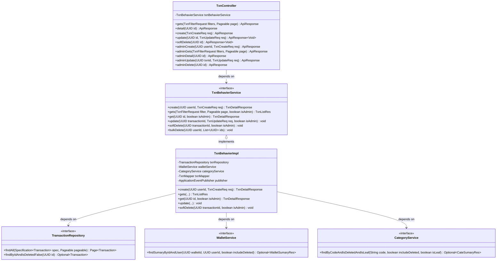
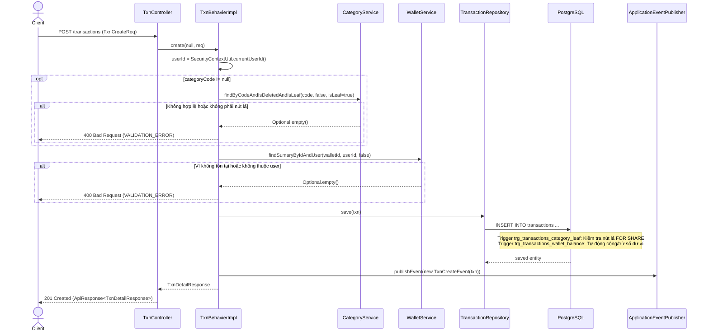

# ĐẶC TẢ RESTFUL API ENDPOINTS — GIAO DỊCH CÁ NHÂN (TRANSACTION)

> **File này trả lời:** Danh sách và đặc tả kỹ thuật chi tiết các RESTful API endpoints phân hệ Giao Dịch Cá Nhân
> (`/transactions`), cấu trúc Request/Response DTO, cơ chế phân quyền RBAC (User & Admin), cơ chế lọc linh hoạt, tính toán
> số dư ví qua Database Trigger, và kịch bản kiểm thử API.  
> Code chính → [
`TxnController.java`](file:///D:/projects/java/server/src/main/java/com/datn/financeapp/module/transaction/controller/TxnController.java) · [
`TxnBehavierImpl.java`](file:///D:/projects/java/server/src/main/java/com/datn/financeapp/module/transaction/service/impl/TxnBehavierImpl.java) ·
> Luồng xử lý chi tiết → [docs/work_flow/txn.md](../work_flow/txn.md)

---

## 📑 MỤC LỤC

- [1. Quy ước chung](#1-quy-uoc-chung)
- [2. Danh mục Endpoint Tổng hợp](#2-danh-muc-endpoint)
- [3. Đặc tả Chi tiết Endpoints](#3-dac-ta-chi-tiet-endpoints)
    - [3.1 Danh sách & Bộ lọc giao dịch (`GET /transactions`)](#31-danh-sach-giao-dich)
    - [3.2 Xem chi tiết giao dịch (`GET /transactions/{id}`)](#32-chi-tiet-giao-dich)
    - [3.3 Tạo giao dịch mới (`POST /transactions`)](#33-tao-giao-dich)
    - [3.4 Cập nhật giao dịch (`PATCH /transactions/{id}`)](#34-cap-nhat-giao-dich)
    - [3.5 Xóa mềm giao dịch (`DELETE /transactions/{id}`)](#35-xoa-giao-dich)
    - [3.6 Các Endpoint Quản trị viên (`/transactions/admin`)](#36-admin-endpoints)
- [4. Cấu trúc Thực thể JPA và DTO](#4-cau-truc-thuc-the-va-dto)
- [5. Biểu đồ Lớp Phân tầng (Spring Boot Class Diagram)](#5-bieu-do-lop-phan-tang)
- [6. Biểu đồ Tuần tự (Sequence Diagrams)](#6-bieu-do-tuan-tu)
- [7. Bảng Ma trận Mã lỗi (Error Code Matrix)](#7-bang-ma-tran-ma-loi)
- [8. Kịch bản Kiểm thử REST API (Spring Boot Test Cases)](#8-kich-ban-kiem-thu-rest-api)

---

## 1. Quy ước chung <a id="1-quy-uoc-chung"></a>

- **Base URL:** `/transactions`
- **Định dạng dữ liệu:** `Content-Type: application/json`, `Accept: application/json`.
- **Quy ước đặt tên thuộc tính JSON:** Cấu hình chuẩn `snake_case` toàn hệ thống.
- **Đóng gói chuẩn:** Mọi response trả về bọc trong `ApiResponse<T>`:
  ```json
  {
    "success": true,
    "code": 200,
    "message": "Thành công",
    "data": { ... }
  }
  ```
- **Xác thực phiên:** Header bắt buộc: `Authorization: Bearer <accessToken>`.
- **Cơ chế phân quyền RBAC:**
    - Luồng User (`/transactions/**`): Người dùng thao tác trên dữ liệu ví và giao dịch thuộc sở hữu của chính mình.
    - Luồng Admin (`/transactions/admin/**`):
        - Đọc (`GET`): Quyền `transactions:read` (`PermissionName.TXN_READ`).
        - Tạo & Sửa (`POST`, `PATCH`): Quyền `transactions:update` (`PermissionName.TXN_UPDATE`).
        - Xóa (`DELETE`): Quyền `transactions:delete` (`PermissionName.TXN_DELETE`).
- **Nguyên tắc số dư ví:** Backend Java **không** tự cộng trừ `wallet.balance`. Việc tính toán số dư ví được thực thi
  hoàn toàn tự động bởi Database Trigger `trg_transactions_wallet_balance` ([
  `V7`](file:///D:/projects/java/server/src/main/resources/db/migration_v2/V7__trigger_wallet_balance.sql)) khi thêm,
  sửa, xóa bản ghi trên bảng `transactions`.
- **Ràng buộc danh mục lá:** Trigger `trg_transactions_category_leaf` ([
  `V11`](file:///D:/projects/java/server/src/main/resources/db/migration_v2/V11__trigger_transaction_category_leaf.sql))
  khóa dòng `FOR SHARE` đảm bảo giao dịch chỉ được gắn vào danh mục lá (`is_leaf = true`) chưa xóa.

---

## 2. Danh mục Endpoint Tổng hợp <a id="2-danh-muc-endpoint"></a>

| Phương thức  | Endpoint                   | Quyền hạn yêu cầu     | Idempotent | Mô tả                                                        |
|:-------------|:---------------------------|:----------------------|:----------:|:-------------------------------------------------------------|
| **`GET`**    | `/transactions`            | Đã đăng nhập          |   Không    | Danh sách giao dịch cá nhân phân trang theo bộ lọc linh hoạt |
| **`GET`**    | `/transactions/{id}`       | Đã đăng nhập          |   Không    | Xem chi tiết một giao dịch cá nhân kèm ví và danh mục        |
| **`POST`**   | `/transactions`            | Đã đăng nhập          |   **Có**   | Tạo giao dịch cá nhân mới (`EXPENSE`, `INCOME`, `LOAN`)      |
| **`PATCH`**  | `/transactions/{id}`       | Đã đăng nhập          |   Không    | Cập nhật thông tin giao dịch, đổi ví, đổi danh mục           |
| **`DELETE`** | `/transactions/{id}`       | Đã đăng nhập          |   Không    | Xóa mềm giao dịch cá nhân và trigger hoàn trả số dư ví       |
| **`POST`**   | `/transactions/admin`      | `transactions:update` |   Không    | Admin tạo hộ giao dịch cho người dùng chỉ định qua `user_id` |
| **`GET`**    | `/transactions/admin`      | `transactions:read`   |   Không    | Admin tra cứu danh sách toàn bộ giao dịch hệ thống           |
| **`GET`**    | `/transactions/admin/{id}` | `transactions:read`   |   Không    | Admin xem chi tiết bất kỳ giao dịch nào trong hệ thống       |
| **`PATCH`**  | `/transactions/admin`      | `transactions:update` |   Không    | Admin sửa giao dịch bất kỳ theo `txn_id`                     |
| **`DELETE`** | `/transactions/admin/{id}` | `transactions:delete` |   Không    | Admin xóa mềm giao dịch bất kỳ                               |

---

## 3. Đặc tả Chi tiết Endpoints <a id="3-dac-ta-chi-tiet-endpoints"></a>

### 3.1 Danh sách & Bộ lọc giao dịch (`GET /transactions`) <a id="31-danh-sach-giao-dich"></a>

Lấy danh sách các giao dịch cá nhân (chưa xóa mềm) của người dùng hiện tại, có hỗ trợ phân trang và bộ lọc đa tiêu chí.

- **Method / Path:** `GET /transactions`
- **Headers:** `Authorization: Bearer <accessToken>`
- **Query Parameters (`TxnFilterReq` & `Pageable`):**

| Tham số Query    | Kiểu             | Mô tả                                                             |
|:-----------------|:-----------------|:------------------------------------------------------------------|
| `page`           | Integer          | Số trang (0-indexed, mặc định: 0)                                 |
| `size`           | Integer          | Kích thước trang (mặc định: 20)                                   |
| `sort`           | String           | Sắp xếp (ví dụ: `occurredAt,desc` hoặc `createdAt,desc`)          |
| `from`           | ISO-8601 Instant | Lọc từ mốc thời gian phát sinh giao dịch                          |
| `to`             | ISO-8601 Instant | Lọc đến mốc thời gian phát sinh giao dịch                         |
| `period`         | String           | Khoảng thời gian định sẵn (`week`, `month`, `quarter`, `year`)    |
| `type`           | String           | Loại giao dịch: `EXPENSE`, `INCOME`, `LOAN`                       |
| `wallet_id`      | UUID             | Lọc giao dịch phát sinh từ ví chỉ định                            |
| `category_codes` | List\<String\>   | Danh sách mã danh mục cần lọc                                     |
| `search`         | String           | Tìm kiếm từ khóa theo tên hiển thị (`name`) hoặc ghi chú (`note`) |
| `min_amount`     | Long             | Số tiền tối thiểu                                                 |
| `max_amount`     | Long             | Số tiền tối đa                                                    |

- **Response Status:** `200 OK`
- **Response Body (`ApiResponse<TxnListRes>`):**

```json
{
  "success": true,
  "code": 200,
  "message": "Thành công",
  "data": {
    "txns": [
      {
        "id": "a1b2c3d4-e5f6-7a8b-9c0d-1e2f3a4b5c6d",
        "type": "EXPENSE",
        "amount": 45000,
        "occurred_at": "2026-10-19T08:30:00Z",
        "name": "Bữa sáng phở bò",
        "wallet_id": "b2c3d4e5-f6a7-8b9c-0d1e-2f3a4b5c6d7e",
        "category_code": "an_sang"
      }
    ],
    "page": {
      "page_number": 0,
      "page_size": 20,
      "total_elements": 1,
      "total_pages": 1,
      "is_first": true,
      "is_last": true
    }
  }
}
```

---

### 3.2 Xem chi tiết giao dịch (`GET /transactions/{id}`) <a id="32-chi-tiet-giao-dich"></a>

Xem đầy đủ thông tin chi tiết một giao dịch cá nhân kèm thông tin tóm tắt của ví và danh mục liên kết.

- **Method / Path:** `GET /transactions/{id}`
- **Path Variables:** `id` (UUID, required) — ID giao dịch.
- **Response Status:** `200 OK`
- **Response Body (`ApiResponse<TxnDetailResponse>`):**

```json
{
  "success": true,
  "code": 200,
  "message": "Thành công",
  "data": {
    "id": "a1b2c3d4-e5f6-7a8b-9c0d-1e2f3a4b5c6d",
    "wallet": {
      "id": "b2c3d4e5-f6a7-8b9c-0d1e-2f3a4b5c6d7e",
      "name": "Ví Tiền mặt",
      "icon": "default_wallet",
      "color": "#3d6b7d",
      "balance": 1500000
    },
    "category": {
      "name": "Ăn sáng",
      "code": "an_sang",
      "icon": "M4 12a8 4 0 0116 0v4a2 2 0 01-2 2H6a2 2 0 01-2-2z",
      "color": "#3d6b7d"
    },
    "type": "EXPENSE",
    "amount": 45000,
    "occurred_at": "2026-10-19T08:30:00Z",
    "display_name": "Bữa sáng phở bò",
    "note": "Ăn cùng đồng nghiệp",
    "created_at": "2026-10-19T08:35:10Z",
    "updated_at": "2026-10-19T08:35:10Z"
  }
}
```

- **Mã lỗi có thể gặp:**
    - `404 Not Found`: Giao dịch không tồn tại, đã bị xóa mềm, hoặc thuộc sở hữu của người dùng khác (`NOT_FOUND`,
      "Không tìm thấy giao dịch.").

---

### 3.3 Tạo giao dịch mới (`POST /transactions`) <a id="33-tao-giao-dich"></a>

Tạo mới giao dịch thu/chi/cho vay cá nhân. Trigger DB sẽ tự động kiểm tra danh mục lá và cập nhật số dư ví tương ứng.

- **Method / Path:** `POST /transactions`
- **Headers:** `Authorization: Bearer <accessToken>`, `Idempotency-Key: <UUID>`
- **Request Body (`TxnCreateReq`):**

| Trường          | Kiểu    | Bắt buộc | Ràng buộc validation              | Mô tả                                                   |
|:----------------|:--------|:--------:|:----------------------------------|:--------------------------------------------------------|
| `type`          | TxnType |    Có    | `@NotNull`                        | Loại: `EXPENSE` (chi), `INCOME` (thu), `LOAN` (cho vay) |
| `amount`        | Long    |    Có    | `@NotNull`, `@PositiveOrZero`     | Số tiền giao dịch (luôn > 0)                            |
| `wallet_id`     | UUID    |    Có    | `@NotNull`                        | ID ví phát sinh giao dịch (phải thuộc user)             |
| `category_code` | String  |  Không   | Tồn tại, chưa xóa, phải là nút lá | Mã danh mục thu/chi                                     |
| `occurred_at`   | Instant |    Có    | `@NotNull`, `@PastOrPresent`      | Thời điểm phát sinh giao dịch (không được ở tương lai)  |
| `display_name`  | String  |  Không   | `@Size(max = 150)`                | Tên hiển thị giao dịch                                  |
| `note`          | String  |  Không   | `@Size(max = 500)`                | Ghi chú thêm                                            |

**Request Body mẫu:**

```json
{
  "type": "EXPENSE",
  "amount": 55000,
  "wallet_id": "b2c3d4e5-f6a7-8b9c-0d1e-2f3a4b5c6d7e",
  "category_code": "ca_phe",
  "occurred_at": "2026-10-19T09:15:00Z",
  "display_name": "Cà phê sáng",
  "note": "Ghé quán quen"
}
```

- **Response Status:** `201 Created`
- **Response Body (`ApiResponse<TxnDetailResponse>`):** Trả về chi tiết giao dịch vừa tạo.
- **Mã lỗi:**
    - `400 Bad Request`: `occurred_at` trong tương lai, danh mục không phải nút lá (`TRANSACTION_CATEGORY_NOT_LEAF`), ví
      không hợp lệ (`VALIDATION_ERROR`).
    - `404 Not Found`: Ví không tồn tại hoặc không thuộc user.

---

### 3.4 Cập nhật giao dịch (`PATCH /transactions/{id}`) <a id="34-cap-nhat-giao-dich"></a>

Cập nhật thông tin giao dịch cá nhân. Có thể đổi loại giao dịch, số tiền, ngày phát sinh, ví hoặc danh mục.

- **Method / Path:** `PATCH /transactions/{id}`
- **Path Variables:** `id` (UUID, required) — ID giao dịch cần cập nhật.
- **Request Body (`TxnUpdateReq`):** Các trường `null` sẽ được giữ nguyên giá trị cũ.

```json
{
  "type": "EXPENSE",
  "amount": 60000,
  "wallet_id": "b2c3d4e5-f6a7-8b9c-0d1e-2f3a4b5c6d7e",
  "category_code": "ca_phe",
  "occured_at": "2026-10-19T09:30:00Z",
  "display_name": "Cà phê & Bánh ngọt",
  "note": "Cập nhật lại số tiền"
}
```

- **Response Status:** `200 OK`
- **Response Body:** `ApiResponse<Void>`
- **Mã lỗi:**
    - `400 Bad Request`: Số tiền `<= 0`, `occured_at` ở tương lai, danh mục mới không phải nút lá.
    - `404 Not Found`: Giao dịch không tồn tại hoặc thuộc người khác.

---

### 3.5 Xóa mềm giao dịch (`DELETE /transactions/{id}`) <a id="35-xoa-giao-dich"></a>

Xóa mềm giao dịch (`is_deleted = true`). Database trigger sẽ tự động hoàn trả số dư ví (ví dụ xóa khoản `EXPENSE` sẽ
cộng lại tiền vào ví).

- **Method / Path:** `DELETE /transactions/{id}`
- **Path Variables:** `id` (UUID, required) — ID giao dịch.
- **Response Status:** `200 OK`
- **Response Body:** `ApiResponse<Void>`
- **Mã lỗi:**
    - `404 Not Found`: Giao dịch không tồn tại hoặc đã bị xóa mềm trước đó.

---

### 3.6 Các Endpoint Quản trị viên (`/transactions/admin`) <a id="36-admin-endpoints"></a>

| Method & Path                               | Quyền hạn             | Mô tả                                                                                     |
|:--------------------------------------------|:----------------------|:------------------------------------------------------------------------------------------|
| `POST /transactions/admin?user_id={userId}` | `transactions:update` | Admin tạo hộ giao dịch cho người dùng                                                     |
| `GET /transactions/admin`                   | `transactions:read`   | Admin lọc danh sách giao dịch toàn hệ thống hoặc theo `user_id`, xem được cả `is_deleted` |
| `GET /transactions/admin/{id}`              | `transactions:read`   | Admin xem chi tiết bất kỳ giao dịch nào                                                   |
| `PATCH /transactions/admin?txn_id={txnId}`  | `transactions:update` | Admin cập nhật giao dịch của người dùng khác                                              |
| `DELETE /transactions/admin/{id}`           | `transactions:delete` | Admin xóa mềm giao dịch của người dùng khác                                               |

---

## 4. Cấu trúc Thực thể JPA và DTO <a id="4-cau-truc-thuc-the-va-dto"></a>

### Thực thể `Transaction`

```java

@Entity
@Table(name = "transactions")
public class Transaction extends AssignedIdEntity {
    @Id
    private UUID id;
    @Column(name = "user_id", nullable = false)
    private UUID userId;
    @Column(name = "wallet_id", nullable = false)
    private UUID walletId;
    @Column(name = "category_code")
    private String categoryCode;
    @Enumerated(EnumType.STRING)
    @Column(name = "type", nullable = false)
    private TxnType type;
    @Column(name = "name")
    private String name;
    @Column(name = "amount", nullable = false)
    private Long amount;
    @Column(name = "note")
    private String note;
    @Column(name = "occurred_at", nullable = false)
    private Instant occurredAt;
    // isDeleted, createdAt, updatedAt kế thừa từ AssignedIdEntity
}
```

### Enum `TxnType`

- `EXPENSE`: Khoản chi tiêu (trừ tiền ví).
- `INCOME`: Khoản thu nhập (cộng tiền ví).
- `LOAN`: Khoản cho vay (trừ tiền ví).

---

## 5. Biểu đồ Lớp Phân tầng (Spring Boot Class Diagram) <a id="5-bieu-do-lop-phan-tang"></a>



---

## 6. Biểu đồ Tuần tự (Sequence Diagrams) <a id="6-bieu-do-tuan-tu"></a>

### Luồng Tạo giao dịch mới (`POST /transactions`)



---

## 7. Bảng Ma trận Mã lỗi (Error Code Matrix) <a id="7-bang-ma-tran-ma-loi"></a>

| Mã lỗi                          | HTTP Status       | Mô tả nguyên nhân                                                                               |
|:--------------------------------|:------------------|:------------------------------------------------------------------------------------------------|
| `VALIDATION_ERROR`              | `400 Bad Request` | Số tiền `<= 0`, ngày phát sinh ở tương lai, ví hoặc danh mục không hợp lệ                       |
| `TRANSACTION_CATEGORY_NOT_LEAF` | `400 Bad Request` | Trigger CSDL chặn khi danh mục được gán không phải là nút lá                                    |
| `FORBIDDEN`                     | `403 Forbidden`   | Thiếu quyền `transactions:read`, `transactions:update` hoặc `transactions:delete` ở luồng Admin |
| `NOT_FOUND`                     | `404 Not Found`   | Giao dịch không tồn tại, đã bị xóa mềm, hoặc thuộc người dùng khác                              |
| `REQUEST_IN_PROGRESS`           | `409 Conflict`    | Trùng lặp `Idempotency-Key` đang trong quá trình xử lý                                          |

---

## 8. Kịch bản Kiểm thử REST API (Spring Boot Test Cases) <a id="8-kich-ban-kiem-thu-rest-api"></a>

| Mã Test Case  | Loại test       | Mô tả kịch bản                      | Đầu vào HTTP Request                                                | Tiền điều kiện CSDL              | Kỳ vọng                                             |
|:--------------|:----------------|:------------------------------------|:--------------------------------------------------------------------|:---------------------------------|:----------------------------------------------------|
| **TC_TXN_01** | Luồng chuẩn     | Tạo khoản chi thành công            | `POST /transactions`<br>Body: EXPENSE 50k, ví A, danh mục `an_sang` | Ví A thuộc user, `an_sang` là lá | `201 Created`, số dư ví giảm 50k                    |
| **TC_TXN_02** | Validation      | Báo lỗi khi số tiền <= 0            | `POST /transactions`<br>Body: amount = 0                            | Bất kỳ                           | `400 Bad Request`                                   |
| **TC_TXN_03** | Validation      | Báo lỗi khi ngày ở tương lai        | `POST /transactions`<br>Body: occurred_at = ngày mai                | Bất kỳ                           | `400 Bad Request`                                   |
| **TC_TXN_04** | Cách ly dữ liệu | Không xem được giao dịch người khác | `GET /transactions/{id}` của user khác                              | Giao dịch của User B             | `404 Not Found`                                     |
| **TC_TXN_05** | Trigger lá      | Báo lỗi khi gán danh mục cha        | `POST /transactions`<br>Body: category_code = `an_uong` (cha)       | `an_uong` có con `an_sang`       | `400 Bad Request` (`VALIDATION_ERROR` / `NOT_LEAF`) |
| **TC_TXN_06** | Hoàn tiền ví    | Xóa mềm hoàn trả số dư              | `DELETE /transactions/{id}` của khoản chi 50k                       | Giao dịch tồn tại                | `200 OK`, số dư ví tự tăng lại 50k qua trigger      |
| **TC_TXN_07** | Admin RBAC      | Admin xem giao dịch toàn hệ thống   | `GET /transactions/admin`<br>Token quyền `transactions:read`        | Có giao dịch của nhiều user      | `200 OK`, trả về danh sách toàn hệ thống            |
| **TC_TXN_08** | Admin RBAC      | Từ chối Admin nếu thiếu quyền       | `GET /transactions/admin`<br>Token User thường                      | User thường                      | `403 Forbidden`                                     |
