# BÁO CÁO THIẾT KẾ CƠ SỞ DỮ LIỆU: MÔ HÌNH ER VÀ CSDL QUAN HỆ

**Dự án:** Ứng dụng Quản lý Tài chính Cá nhân và Nhóm thông minh (Finance App with AI)  
**Hệ quản trị CSDL:** PostgreSQL 16+

---

## 📑 MỤC LỤC

- [PHẦN I: XÂY DỰNG MÔ HÌNH THỰC THỂ LIÊN KẾT (ER MODEL)](#phan-i)
    - [1. Xác định các tập thực thể](#1-xac-dinh-cac-tap-thuc-the)
    - [2. Xác định mối liên kết giữa các tập thực thể](#2-xac-dinh-moi-lien-ket)
    - [3. Xác định các thuộc tính và kiểu thuộc tính của các tập thực thể](#3-xac-dinh-thuoc-tinh)
    - [4. Lược đồ thực thể liên kết ER (ER Diagram)](#4-luoc-do-er)
- [PHẦN II: XÂY DỰNG CƠ SỞ DỮ LIỆU QUAN HỆ (RELATIONAL DATABASE)](#phan-ii)
    - [1. Các lược đồ quan hệ](#1-cac-luoc-do-quan-he)
    - [2. Xác định phụ thuộc hàm và phân tích dạng chuẩn](#2-phu-thuoc-ham-va-chuan-hoa)
        - [2.1 Tập các phụ thuộc hàm (Functional Dependencies)](#21-tap-phu-thuoc-ham)
        - [2.2 Phân tích và chứng minh các dạng chuẩn (1NF, 2NF, 3NF, BCNF)](#22-phan-tich-chuan-hoa)

---

# PHẦN I: XÂY DỰNG MÔ HÌNH THỰC THỂ LIÊN KẾT (ER MODEL) 

## 1. Xác định các tập thực thể 

Hệ thống quản lý tài chính cá nhân và nhóm được cấu trúc thành 4 phân hệ cốt lõi với **27 tập thực thể**:

### 1.1 Phân hệ Người dùng, Phân quyền & Hạ tầng xác thực (Auth & RBAC)

1. **`User` (`users`):** Lưu trữ thông tin tài khoản người dùng, định danh đăng nhập, hồ sơ cá nhân và gói cước sử dụng
   (`free`, `premium`).
2. **`Role` (`roles`):** Định nghĩa vai trò hệ thống (`ROLE_ADMIN`, `ROLE_USER`) kèm cấp bậc ưu tiên (`level`).
3. **`Permission` (`permissions`):** Định nghĩa các quyền hạn tác vụ chi tiết theo chuẩn `resource:action` (ví dụ:
   `users:read`, `roles:update`).
4. **`UserRole` (`user_roles`):** Thực thể liên kết thể hiện mối quan hệ nhiều-nhiều giữa `User` và `Role`.
5. **`RolePermission` (`role_permissions`):** Thực thể liên kết thể hiện mối quan hệ nhiều-nhiều giữa `Role` và
   `Permission`.
6. **`RefreshToken` (`refresh_tokens`):** Lưu trữ phiên làm việc của người dùng, hỗ trợ cơ chế xoay vòng token (Token
   Rotation) và thu hồi phiên.
7. **`LoginAttempt` (`login_attempts`):** Nhật ký kiểm toán các lượt đăng nhập, lưu trữ IP, User-Agent nhằm phục vụ bảo
   mật và chống tấn công Brute-force.
8. **`IdempotencyKey` (`idempotency_keys`):** Đảm bảo tính bất biến (idempotency) của các request nhạy cảm, chống ghi
   đúp dữ liệu khi mạng chập chờn.

### 1.2 Phân hệ Ví tiền & Danh mục thu chi (Wallet & Category)

9. **`Wallet` (`wallets`):** Các ví tiền cá nhân của người dùng (tiền mặt, tài khoản ngân hàng, ví điện tử, thẻ tín
   dụng).
10. **`Icon` (`icons`):** Kho biểu tượng đồ họa hệ thống (SVG paths) dùng chung cho danh mục và mục tiêu tài chính.
11. **`Category` (`categories`):** Cây danh mục thu/chi nhiều cấp do admin quản lý, dùng chung cho mọi người dùng.
    Không phân biệt thu/chi: danh mục không có cha là danh mục gốc. Mỗi nút giữ `level`, `path` và `is_leaf`; giao dịch
    chỉ được gắn vào danh mục lá.

### 1.3 Phân hệ Giao dịch & Kế hoạch tài chính cá nhân (Transaction & Financial Planning)

12. **`Transaction` (`transactions`):** Thực thể trung tâm lưu trữ toàn bộ giao dịch chi tiêu (`expense`), thu nhập
    (`income`) và chuyển tiền giữa các ví (`transfer`).
13. **`RecurringTransaction` (`recurring_transactions`):** Thiết lập các khoản thu/chi định kỳ lặp lại tự động theo
    ngày/tuần/tháng/năm.
14. **`AiDraft` (`ai_drafts`):** Bản nháp giao dịch được AI trích xuất tự động từ văn bản tự nhiên hoặc ảnh hóa đơn
    (OCR).
15. **`Budget` (`budgets`):** Hạn mức ngân sách chi tiêu được thiết lập theo danh mục và chu kỳ thời gian, kèm số đã chi trong kỳ.
16. **`Debt` (`debts`):** Sổ theo dõi công nợ cá nhân (cho vay - `lending` hoặc đi vay - `borrowing`).
17. **`DebtPayment` (`debt_payments`):** Lịch sử các lần thanh toán, trả bớt hoặc tất toán từng khoản nợ.
18. **`SavingsGoal` (`savings_goals`):** Mục tiêu tích lũy tài chính trong tương lai kèm số tiền đích và hạn định.
19. **`GoalContribution` (`goal_contributions`):** Lịch sử các đợt nạp tiền tích lũy vào mục tiêu tiết kiệm.
20. **`Notification` (`notifications`):** Hộp thư thông báo trong ứng dụng (cảnh báo vượt ngân sách, nhắc nợ, tự động
    ghi sổ).
21. **`ExportJob` (`export_jobs`):** Quản lý tiến trình tác vụ xuất báo cáo tài chính bất đồng bộ (CSV, Excel, PDF).

### 1.4 Phân hệ Nhóm chung quỹ (Group - Mô hình hai sổ độc lập)

22. **`Group` (`groups`):** Không gian quản lý chi tiêu nhóm, độc lập hoàn toàn với sổ ghi cá nhân.
23. **`GroupMember` (`group_members`):** Tư cách thành viên của người dùng trong nhóm trong từng khoảng thời gian
    (`joined_at` đến `left_at`).
24. **`GroupFund` (`group_funds`):** Quỹ tiền mặt/tài khoản chung duy nhất của nhóm do một thành viên (thủ quỹ -
    `keepper_id`) nắm giữ.
25. **`GroupTransaction` (`group_transactions`):** Lịch sử các giao dịch phát sinh của nhóm (`EXPENSE`, `CONTRIBUTION`,
    `REFUND`, `ADJUSTMENT_UP`, `ADJUSTMENT_DOWN`).
26. **`GroupTransactionParticipant` (`group_transaction_participants`):** Danh sách thành viên cùng chịu trách nhiệm chi
    phí kèm số tiền phân bổ (`share_amount`).
27. **`GroupMemberBalance` (`group_member_balances`):** Bảng tổng hợp số dư tích luỹ của từng thành viên (tiền chi hộ,
    góp quỹ, hoàn trả, phần chia chịu) phục vụ quyết toán nợ nội bộ.

---

## 2. Xác định mối liên kết giữa các tập thực thể 

### 2.1 Bảng tổng hợp mối liên kết và bản số (Multiplicity)

| STT | Thực thể nguồn         | Mối liên kết (Verb) | Thực thể đích                                | Bản số (Card.) | Ý nghĩa nghiệp vụ                                                                       |
|:---:|:-----------------------|:-------------------:|:---------------------------------------------|:--------------:|:----------------------------------------------------------------------------------------|
|  1  | `User`                 |       sở hữu        | `Wallet`                                     |   $1 : 0..N$   | Một người dùng có thể tạo nhiều ví tiền; một ví thuộc đúng một người dùng.              |
|  2  | `User`                 |      thực hiện      | `Transaction`                                |   $1 : 0..N$   | Một người dùng tạo nhiều giao dịch thu, chi, chuyển tiền.                               |
|  3  | `Wallet`               |    nguồn chi/thu    | `Transaction`                                |   $1 : 0..N$   | Mỗi giao dịch bắt buộc gắn với một ví nguồn (`wallet_id`).                              |
|  4  | `Wallet`               |  đích chuyển tiền   | `Transaction`                                | $0..1 : 0..N$  | Giao dịch loại `transfer` có ví nhận (`destination_wallet_id`).                         |
|  5  | `Category`             |      phân loại      | `Transaction`                                | $0..1 : 0..N$  | Giao dịch `expense`/`income` bắt buộc gắn với một danh mục; `transfer` thì không.       |
|  6  | `Category`             |     cấp cha của     | `Category`                                   | $0..1 : 0..N$  | Quan hệ phản thân (đệ quy) biểu diễn cây danh mục tối đa 2 cấp.                         |
|  7  | `CategoryGroup`        |      gom nhóm       | `Category`                                   | $0..1 : 0..N$  | Mỗi nhóm lớn chứa nhiều danh mục gốc.                                                   |
|  8  | `Icon`                 |   đại diện đồ họa   | `Category` / `CategoryGroup` / `SavingsGoal` |   $1 : 0..N$   | Biểu tượng SVG được tái sử dụng qua nhiều thực thể giao diện.                           |
|  9  | `Wallet` - `Category`  |  liên kết cấu hình  | `WalletCategorySetting`                      |    $N : N$     | Cấu hình bật/tắt từng danh mục trên từng ví cá nhân.                                    |
| 10  | `RecurringTransaction` |   tự động sinh ra   | `Transaction`                                | $0..1 : 0..N$  | Một thiết lập định kỳ tự động sinh ra nhiều giao dịch thực tế theo thời gian.           |
| 11  | `AiDraft`              |  chuyển đổi thành   | `Transaction`                                | $0..1 : 0..1$  | Một bản nháp AI sau khi người dùng xác nhận sẽ tạo thành đúng một giao dịch.            |
| 12  | `User`                 |      thiết lập      | `Budget`                                     |   $1 : 0..N$   | Người dùng tạo các hạn mức ngân sách chi tiêu.                                          |
| 13  | `Category`             |   áp dụng hạn mức   | `Budget`                                     |   $1 : 0..N$   | Ngân sách bắt buộc áp dụng cho một danh mục chi (`expense`).                            |
| 14  | `Transaction`          |   sinh ra gốc nợ    | `Debt`                                       |    $1 : 1$     | Mỗi khoản nợ/cho vay bắt nguồn từ một giao dịch tiền mặt gốc (`origin_transaction_id`). |
| 15  | `Debt`                 |    được trả bởi     | `DebtPayment`                                |   $1 : 0..N$   | Một khoản nợ có thể được thanh toán qua nhiều đợt.                                      |
| 16  | `Transaction`          |  thực hiện trả nợ   | `DebtPayment`                                |    $1 : 1$     | Mỗi đợt trả nợ gắn chặt với một giao dịch tài chính đối ứng.                            |
| 17  | `SavingsGoal`          |    nhận tích lũy    | `GoalContribution`                           |   $1 : 0..N$   | Mục tiêu tiết kiệm nhận nhiều lần đóng góp tiền.                                        |
| 18  | `Transaction`          |    nạp tích lũy     | `GoalContribution`                           |   $0..1 : 1$   | Lần nạp tiền có thể liên kết với một giao dịch trừ tiền ví.                             |
| 19  | `User` - `Role`        |     gán vai trò     | `UserRole`                                   |    $N : N$     | Một người dùng có nhiều vai trò; một vai trò gán cho nhiều người.                       |
| 20  | `Role` - `Permission`  |    gán quyền hạn    | `RolePermission`                             |    $N : N$     | Một vai trò chứa nhiều quyền chi tiết; một quyền thuộc nhiều vai trò.                   |
| 21  | `User`                 |    duy trì phiên    | `RefreshToken`                               |   $1 : 0..N$   | Một tài khoản duy trì các phiên đăng nhập trên nhiều thiết bị.                          |
| 22  | `Group`                |       sở hữu        | `GroupFund`                                  |    $1 : 1$     | **Mỗi nhóm có duy nhất một quỹ chung**, lập cùng lúc với nhóm (`group_id` UNIQUE).      |
| 23  | `User`                 |  giữ quỹ (thủ quỹ)  | `GroupFund`                                  |   $1 : 0..N$   | Quỹ nhóm giao cho một thành viên nắm giữ (`keepper_id`).                                |
| 24  | `Group`                |    có thành viên    | `GroupMember`                                |   $1 : 1..N$   | Nhóm phải có ít nhất 1 thành viên là chủ nhóm (`OWNER`).                                |
| 25  | `User`                 |    tham gia vào     | `GroupMember`                                |   $1 : 0..N$   | Một người có thể tham gia nhiều nhóm hoặc nhiều khoảng thời gian trong cùng một nhóm.   |
| 26  | `Group`                |      phát sinh      | `GroupTransaction`                           |   $1 : 0..N$   | Lịch sử chi tiêu, góp quỹ, kiểm kê của nhóm.                                            |
| 27  | `GroupTransaction`     |     phân bổ cho     | `GroupTransactionParticipant`                |   $1 : 1..N$   | Mỗi khoản giao dịch nhóm phân chia phần chi phí cho các thành viên tham gia.            |
| 28  | `Group` - `User`       |   tổng hợp số dư    | `GroupMemberBalance`                         |    $N : N$     | Lưu trữ số dư delta tích lũy của từng thành viên trong nhóm phục vụ quyết toán.         |

---

## 3. Xác định các thuộc tính và kiểu thuộc tính của các tập thực thể 

### 3.1 Nhóm Người dùng, Vai trò & Hạ tầng xác thực

#### `users` (Tài khoản người dùng)

- `id` (UUID, PK): Khóa chính định danh người dùng.
- `email` (VARCHAR (100), UK, NOT NULL): Địa chỉ email duy nhất, chuẩn hóa chữ thường.
- `password_hash` (VARCHAR (255), NULL): Bản băm BCrypt mật khẩu (NULL nếu đăng nhập Google thuần).
- `first_name` (VARCHAR (100)), `last_name` (VARCHAR (100)): Họ và tên người dùng.
- `avatar_url` (TEXT): Đường dẫn ảnh đại diện.
- `google_id` (VARCHAR (255), UK): Khóa định danh OAuth2 từ Google (`sub`).
- `plan` (VARCHAR (20), NOT NULL, DEFAULT 'free'): Gói dịch vụ (`free`, `premium`).
- `status` (VARCHAR (20), NOT NULL, DEFAULT 'pending_verify'): Trạng thái tài khoản (`pending_verify`, `active`,
  `blocked`).
- `is_deleted` (BOOLEAN, NOT NULL, DEFAULT FALSE): Cờ xóa mềm tài khoản.
- `created_at` (TIMESTAMPTZ, NOT NULL, DEFAULT now ()): Thời điểm khởi tạo tài khoản.

#### `roles` (Vai trò hệ thống)

- `id` (UUID, PK): Khóa chính định danh vai trò.
- `name` (VARCHAR (50), UK, NOT NULL): Tên vai trò duy nhất (`ROLE_ADMIN`, `ROLE_USER`).
- `level` (INT, NOT NULL): Cấp bậc quyền hạn (số càng nhỏ quyền lực càng cao).
- `description` (TEXT): Mô tả vai trò.
- `created_at` (TIMESTAMPTZ, NOT NULL, DEFAULT now ()): Thời điểm tạo vai trò.

#### `permissions` (Quyền hạn chi tiết)

- `id` (UUID, PK): Khóa chính định danh quyền hạn.
- `name` (VARCHAR (100), UK, NOT NULL): Tên quyền chi tiết (`users:read`, `roles:update`).
- `description` (TEXT): Mô tả quyền.
- `created_at` (TIMESTAMPTZ, NOT NULL, DEFAULT now ()): Thời điểm tạo.

#### `role_permissions` (Bảng liên kết Role - Permission)

- `role_id` (UUID, PK, FK $\rightarrow$ `roles.id`): Khóa ngoại tham chiếu vai trò.
- `permission_id` (UUID, PK, FK $\rightarrow$ `permissions.id`): Khóa ngoại tham chiếu quyền hạn.

#### `user_roles` (Bảng liên kết User - Role)

- `user_id` (UUID, PK, FK $\rightarrow$ `users.id`): Khóa ngoại tham chiếu người dùng.
- `role_id` (UUID, PK, FK $\rightarrow$ `roles.id`): Khóa ngoại tham chiếu vai trò.

#### `refresh_tokens` (Phiên đăng nhập xoay vòng)

- `id` (UUID, PK): Khóa chính định danh phiên.
- `user_id` (UUID, FK $\rightarrow$ `users.id`, NOT NULL): Chủ sở hữu phiên.
- `email` (VARCHAR (255), NOT NULL): Email chủ sở hữu (phục vụ thu hồi phiên hàng loạt theo email).
- `token_hash` (VARCHAR (64), UK, NOT NULL): Mã băm SHA-256 của token gốc.
- `expires_at` (TIMESTAMPTZ, NOT NULL): Thời hạn hết hiệu lực.
- `revoked_at` (TIMESTAMPTZ, NULL): Thời điểm bị thu hồi/đã dùng.
- `device_info` (VARCHAR (255)): Thông tin thiết bị client.
- `created_at` (TIMESTAMPTZ, NOT NULL, DEFAULT now ()): Thời điểm phát hành.

#### `login_attempts` (Nhật ký đăng nhập)

- `id` (UUID, PK): Khóa chính định danh.
- `email` (VARCHAR (255), NOT NULL): Địa chỉ email thử đăng nhập.
- `ip_address` (INET): Địa chỉ IP của máy khách.
- `succeeded` (BOOLEAN, NOT NULL): Kết quả đăng nhập (TRUE = thành công, FALSE = thất bại).
- `user_agent` (VARCHAR (255)): Chuỗi nhận dạng trình duyệt/thiết bị.
- `attempted_at` (TIMESTAMPTZ, NOT NULL, DEFAULT now ()): Thời điểm thực hiện.

#### `idempotency_keys` (Kiểm soát ghi trùng lặp)

- `id` (UUID, PK): Khóa chính định danh.
- `idempotency_key` (VARCHAR (255), NOT NULL): Mã khóa idempotency từ client gửi lên.
- `user_id` (UUID, FK $\rightarrow$ `users.id`, NOT NULL): Người dùng gửi request.
- `endpoint` (VARCHAR (255), NOT NULL): Đường dẫn API request.
- `status` (VARCHAR (20), NOT NULL, DEFAULT 'processing'): Trạng thái xử lý (`processing`, `completed`).
- `response_status` (INTEGER): HTTP status code lưu lại.
- `response_body` (JSONB): Dữ liệu phản hồi lưu lại để trả về ngay nếu gọi lại.
- `created_at` (TIMESTAMPTZ, NOT NULL, DEFAULT now ()): Thời điểm ghi nhận.
- *(Ràng buộc: UNIQUE (`idempotency_key`, `user_id`, `endpoint`))*

---

### 3.2 Nhóm Ví & Danh mục thu chi

#### `wallets` (Ví tiền cá nhân)

- `id` (UUID, PK): Định danh duy nhất của ví.
- `user_id` (UUID, FK $\rightarrow$ `users.id`, NOT NULL): Chủ sở hữu ví.
- `name` (VARCHAR (50), NOT NULL): Tên ví (Ví tiền mặt, Techcombank, MoMo...).
- `type` (VARCHAR (20), NOT NULL): Loại ví (`cash`, `bank`, `e_wallet`, `credit_card`).
- `initial_balance` (BIGINT, NOT NULL, DEFAULT 0): Số dư khởi tạo ban đầu.
- `current_balance` (BIGINT, NOT NULL, DEFAULT 0): Số dư hiện tại *(Thuộc tính suy diễn - được cập nhật liên tục qua các
  giao dịch thu/chi/chuyển tiền)*.
- `include_in_total` (BOOLEAN, NOT NULL, DEFAULT TRUE): Cờ cho phép tính vào tổng tài sản hiển thị.
- `icon` (VARCHAR (50)), `color` (CHAR (7)): Mã icon và mã màu HEX giao diện.
- `sort_order` (INTEGER, NOT NULL, DEFAULT 0): Thứ tự sắp xếp.
- `is_default` (BOOLEAN, NOT NULL, DEFAULT FALSE): Ví mặc định nhận các khoản tự ghi từ giao dịch nhóm. Mỗi người dùng luôn có
  đúng một ví mặc định chưa xóa: trigger `trg_users_default_wallet` tạo ví "Tiền mặt" mặc định khi tạo người dùng, constraint
  trigger `trg_wallets_one_default` (hoãn đến lúc commit) chặn xóa mềm ví mặc định hoặc có hai ví mặc định.
- `is_deleted` (BOOLEAN, NOT NULL, DEFAULT FALSE): Cờ xóa mềm ví.
- `created_at` (TIMESTAMPTZ, NOT NULL, DEFAULT now ()): Thời điểm tạo.

#### `icons` (Kho biểu tượng SVG)

- `id` (UUID, PK): Định danh biểu tượng.
- `code` (VARCHAR (50), UK, NOT NULL): Mã định danh duy nhất (`an_uong`, `xe_may`...).
- `display_name` (VARCHAR (100), NOT NULL): Tên hiển thị tiếng Việt.
- `path_data` (TEXT, NOT NULL): Tọa độ vẽ SVG path.
- `icon_group` (VARCHAR (30), NOT NULL): Nhóm phân loại icon.
- `search_keywords` (TEXT): Từ khóa tìm kiếm nhanh.
- `sort_order` (INTEGER, NOT NULL, DEFAULT 0): Thứ tự hiển thị.
- `is_active` (BOOLEAN, NOT NULL, DEFAULT TRUE): Trạng thái khả dụng.

#### `categories` (Cây danh mục thu/chi)

- `id` (UUID, PK): Định danh danh mục.
- `code` (VARCHAR (50), UK, NOT NULL): Mã danh mục duy nhất toàn hệ thống, kể cả danh mục đã xóa mềm.
- `name` (VARCHAR (50), NOT NULL): Tên danh mục (Ăn uống, Tiền điện, Lương...), duy nhất toàn cây trong số danh mục
  chưa xóa.
- `description` (VARCHAR (255), NULL): Mô tả danh mục.
- `parent_id` (UUID, FK $\rightarrow$ `categories.id`, NULL): NULL = danh mục gốc, có giá trị = danh mục con.
- `icon_id` (UUID, FK $\rightarrow$ `icons.id`, NOT NULL): Biểu tượng hiển thị.
- `color` (CHAR (7), NOT NULL): Mã màu hiển thị.
- `level` (INTEGER, NOT NULL, DEFAULT 0): Độ sâu trong cây, gốc = 0.
- `is_leaf` (BOOLEAN, NOT NULL, DEFAULT TRUE): Còn con hay không; giao dịch chỉ gắn vào danh mục lá.
- `path` (VARCHAR (255), NOT NULL): Chuỗi `code` từ gốc tới danh mục, nối bằng `/` (vd. `an_uong/an_sang`).
- `deleted` (BOOLEAN, NOT NULL, DEFAULT FALSE): Cờ xóa mềm.
- `created_at` (TIMESTAMPTZ, NOT NULL, DEFAULT now ()): Thời điểm tạo.

---

### 3.3 Nhóm Giao dịch, Giao dịch định kỳ & Kế hoạch tài chính

#### `transactions` (Giao dịch tài chính trung tâm)

- `id` (UUID, PK): Định danh duy nhất của giao dịch.
- `user_id` (UUID, FK $\rightarrow$ `users.id`, NOT NULL): Người thực hiện giao dịch.
- `wallet_id` (UUID, FK $\rightarrow$ `wallets.id`, NOT NULL): Ví nguồn (bị trừ tiền nếu chi/chuyển, được cộng tiền nếu
  thu).
- `destination_wallet_id` (UUID, FK $\rightarrow$ `wallets.id`, NULL): Ví đích (chỉ dùng khi `type = 'transfer'`).
- `category_id` (UUID, FK $\rightarrow$ `categories.id`, NULL): Danh mục thu/chi (bắt buộc với `expense`/`income`, NULL
  với `transfer`).
- `type` (VARCHAR (10), NOT NULL): Loại giao dịch (`expense`, `income`, `transfer`).
- `amount` (BIGINT, NOT NULL): Số tiền giao dịch (luôn dương $> 0$).
- `date` (DATE, NOT NULL): Ngày phát sinh giao dịch.
- `note` (TEXT): Ghi chú diễn giải giao dịch.
- `display_name` (VARCHAR (150)): Tiêu đề hiển thị ngắn gọn.
- `source` (VARCHAR (20), NOT NULL, DEFAULT 'manual'): Nguồn phát sinh (`manual`, `text`, `ocr`, `auto`, `adjustment`).
- `recurring_id` (UUID, FK $\rightarrow$ `recurring_transactions.id`, NULL): Gắn với giao dịch định kỳ nếu được sinh tự
  động.
- `draft_id` (UUID, FK $\rightarrow$ `ai_drafts.id`, NULL): Gắn với bản nháp AI nếu duyệt từ gợi ý AI.
- `receipt_url` (TEXT): Đường dẫn ảnh hóa đơn lưu trên cloud (Cloudinary/S3).
- `is_deleted` (BOOLEAN, NOT NULL, DEFAULT FALSE): Cờ xóa mềm.
- `created_at` (TIMESTAMPTZ, NOT NULL, DEFAULT now ()): Thời điểm bấm lưu trên hệ thống.
- `updated_at` (TIMESTAMPTZ, NOT NULL, DEFAULT now ()): Thời điểm cập nhật cuối cùng.
- `counts_in_report` (BOOLEAN, NOT NULL, DEFAULT TRUE): Cờ tính vào báo cáo thống kê thu chi (FALSE với giao dịch kiểm
  kê cân bằng ví).

#### `recurring_transactions` (Khoản thu/chi định kỳ)

- `id` (UUID, PK): Định danh giao dịch định kỳ.
- `user_id` (UUID, FK $\rightarrow$ `users.id`, NOT NULL): Người sở hữu.
- `wallet_id` (UUID, FK $\rightarrow$ `wallets.id`, NOT NULL): Ví tiền thực hiện.
- `category_id` (UUID, FK $\rightarrow$ `categories.id`, NOT NULL): Danh mục thu/chi.
- `type` (VARCHAR (10), NOT NULL): Loại (`expense`, `income`).
- `amount` (BIGINT, NOT NULL): Số tiền mỗi kỳ ($> 0$).
- `display_name` (VARCHAR (100), NOT NULL): Tên khoản định kỳ (Tiền thuê nhà, Tiền mạng...).
- `note` (TEXT): Ghi chú.
- `frequency` (VARCHAR (10), NOT NULL): Đơn vị tần suất (`day`, `week`, `month`, `year`).
- `interval` (INTEGER, NOT NULL, DEFAULT 1): Bước nhảy tần suất (ví dụ: mỗi 2 tuần).
- `start_date` (DATE, NOT NULL): Ngày bắt đầu hiệu lực.
- `end_date` (DATE, NULL): Ngày kết thúc (NULL = lặp vô hạn).
- `next_run_date` (DATE, NOT NULL): Ngày tiếp theo hệ thống sẽ quét tự động ghi sổ.
- `last_run_date` (DATE, NULL): Ngày ghi sổ gần nhất.
- `is_enabled` (BOOLEAN, NOT NULL, DEFAULT TRUE): Cờ kích hoạt/tạm dừng.
- `created_at` (TIMESTAMPTZ, NOT NULL, DEFAULT now ()): Thời điểm tạo.

#### `ai_drafts` (Bản nháp giao dịch AI)

- `id` (UUID, PK): Định danh bản nháp.
- `user_id` (UUID, FK $\rightarrow$ `users.id`, NOT NULL): Người dùng yêu cầu phân tích.
- `method` (VARCHAR (20), NOT NULL): Phương thức nhập liệu (`text` - câu lệnh tự nhiên, `ocr` - quét hóa đơn).
- `raw_input` (TEXT, NOT NULL): Dữ liệu thô (câu văn bản hoặc link ảnh).
- `ai_result` (JSONB, NOT NULL): Cấu trúc JSON trích xuất tự động từ Gemini AI (tiền, ngày, danh mục, ví gợi ý).
- `confidence` (NUMERIC (4,3), NOT NULL): Độ tin cậy của mô hình ($0.000 \dots 1.000$).
- `status` (VARCHAR (20), NOT NULL, DEFAULT 'pending'): Trạng thái bản nháp (`pending`, `saved`, `discarded`).
- `transaction_id` (UUID, NULL): Giao dịch thực tế được sinh ra sau khi người dùng bấm xác nhận.
- `user_corrections` (JSONB): Thông tin các trường người dùng sửa lại so với AI gợi ý (dùng để fine-tune/học ngữ cảnh).
- `model_version` (VARCHAR (50)): Tên model AI xử lý.
- `created_at` (TIMESTAMPTZ, NOT NULL, DEFAULT now ()): Thời điểm tạo bản nháp.

#### `budgets` (Ngân sách chi tiêu)

- `id` (UUID, PK): Định danh ngân sách.
- `user_id` (UUID, FK $\rightarrow$ `users.id`, NOT NULL): Người sở hữu.
- `category_id` (UUID, FK $\rightarrow$ `categories.id`, NOT NULL): Danh mục chi tiêu được kiểm soát.
- `spent` (BIGINT, NOT NULL, DEFAULT 0): Số tiền đã chi trong kỳ, cộng trừ nguyên tử khi giao dịch chi thay đổi.
- `limit_amount` (BIGINT, NOT NULL): Số tiền hạn mức tối đa ($> 0$).
- `period_type` (VARCHAR (10), NOT NULL): Chu kỳ (`WEEK`, `MONTH`, `QUARTER`, `YEAR`).
- `start_date` (DATE, NOT NULL), `end_date` (DATE, NOT NULL): Khoảng thời gian hiệu lực.
- `auto_renew` (BOOLEAN, NOT NULL, DEFAULT FALSE): Tự động gia hạn sang chu kỳ kế tiếp.
- `is_active` (BOOLEAN, NOT NULL, DEFAULT TRUE): Trạng thái kích hoạt.
- `created_at` (TIMESTAMPTZ, NOT NULL, DEFAULT now ()): Thời điểm thiết lập.
- *(Ràng buộc chống chồng chéo thời gian: GiST EXCLUDE constraint)*

#### `debts` (Sổ ghi nợ)

- `id` (UUID, PK): Định danh khoản nợ.
- `user_id` (UUID, FK $\rightarrow$ `users.id`, NOT NULL): Người sở hữu khoản nợ.
- `wallet_id` (UUID, FK $\rightarrow$ `wallets.id`, NOT NULL): Ví liên kết dòng tiền ban đầu.
- `type` (VARCHAR (10), NOT NULL): Phân loại (`lending` - cho vay, `borrowing` - đi vay).
- `counterparty_name` (VARCHAR (100), NOT NULL): Tên đối tác vay/cho vay.
- `principal_amount` (BIGINT, NOT NULL): Số tiền nợ gốc ($> 0$).
- `paid_amount` (BIGINT, NOT NULL, DEFAULT 0): Số tiền đã thanh toán *(Thuộc tính suy diễn - tự động cộng dồn từ
  `debt_payments` qua database trigger)*.
- `issued_date` (DATE, NOT NULL): Ngày phát sinh nợ.
- `due_date` (DATE, NULL): Ngày hẹn trả (NULL = không hẹn).
- `note` (TEXT): Ghi chú.
- `status` (VARCHAR (20), NOT NULL, DEFAULT 'outstanding'): Trạng thái (`outstanding` - còn nợ, `settled` - đã trả hết,
  `written_off` - xóa nợ khó đòi).
- `origin_transaction_id` (UUID, FK $\rightarrow$ `transactions.id`, NOT NULL): Giao dịch chi tiêu/thu tiền gốc sinh ra
  khoản nợ này.
- `created_at` (TIMESTAMPTZ, NOT NULL, DEFAULT now ()): Thời điểm ghi sổ.

#### `debt_payments` (Đợt trả nợ)

- `id` (UUID, PK): Định danh đợt trả nợ.
- `debt_id` (UUID, FK $\rightarrow$ `debts.id`, NOT NULL): Khoản nợ tương ứng.
- `transaction_id` (UUID, FK $\rightarrow$ `transactions.id`, UK, NOT NULL): Giao dịch tài chính thu hồi nợ hoặc trả nợ
  tương ứng.
- `amount` (BIGINT, NOT NULL): Số tiền thanh toán đợt này ($> 0$).
- `paid_date` (DATE, NOT NULL): Ngày thanh toán.
- `note` (TEXT): Ghi chú.
- `created_at` (TIMESTAMPTZ, NOT NULL, DEFAULT now ()): Thời điểm ghi nhận.

#### `savings_goals` (Mục tiêu tích lũy)

- `id` (UUID, PK): Định danh mục tiêu.
- `user_id` (UUID, FK $\rightarrow$ `users.id`, NOT NULL): Người thiết lập mục tiêu.
- `wallet_id` (UUID, FK $\rightarrow$ `wallets.id`, NULL): Ví dùng để nạp tiết kiệm (nếu có chỉ định).
- `name` (VARCHAR (100), NOT NULL): Tên mục tiêu (Mua xe máy, Mua laptop, Quỹ khẩn cấp...).
- `target_amount` (BIGINT, NOT NULL): Số tiền mục tiêu cần tích lũy ($> 0$).
- `saved_amount` (BIGINT, NOT NULL, DEFAULT 0): Số tiền hiện đã gom được *(Thuộc tính suy diễn - tự động cộng dồn từ
  `goal_contributions` qua database trigger)*.
- `target_date` (DATE, NULL): Ngày dự kiến hoàn thành.
- `icon_id` (UUID, FK $\rightarrow$ `icons.id`, NULL): Biểu tượng mục tiêu.
- `status` (VARCHAR (20), NOT NULL, DEFAULT 'in_progress'): Trạng thái (`in_progress`, `completed`, `cancelled`).
- `created_at` (TIMESTAMPTZ, NOT NULL, DEFAULT now ()): Thời điểm tạo.

#### `goal_contributions` (Lần nạp tiền tiết kiệm)

- `id` (UUID, PK): Định danh lần nạp tiền.
- `goal_id` (UUID, FK $\rightarrow$ `savings_goals.id`, NOT NULL): Mục tiêu tiết kiệm nhận tiền.
- `transaction_id` (UUID, FK $\rightarrow$ `transactions.id`, NULL): Giao dịch chuyển tiền tương ứng từ ví sang tiết
  kiệm (nếu có).
- `amount` (BIGINT, NOT NULL): Số tiền nạp tích lũy ($> 0$).
- `contributed_date` (DATE, NOT NULL): Ngày nạp tiền.
- `created_at` (TIMESTAMPTZ, NOT NULL, DEFAULT now ()): Thời điểm ghi nhận.

#### `notifications` (Hộp thư thông báo)

- `id` (UUID, PK): Định danh thông báo.
- `user_id` (UUID, FK $\rightarrow$ `users.id`, NOT NULL): Người nhận thông báo.
- `type` (VARCHAR (50), NOT NULL): Loại thông báo, lưu tên hằng của enum `NotiType` (`BUDGET_ALERT`, `DEBT_REMINDER`,
  `RECURRING_GENERATED`, `BUDGET_RENEWED`, `GOAL_COMPLETED`, `GROUP_TXN_REVIEW_REQUEST`, `GROUP_TXN_CONSENT_REQUEST`,
  `GROUP_TXN_RECORDED`). App dựa vào đây để chọn icon và
  màn hình đích.
- `title` (VARCHAR (150), NOT NULL): Tiêu đề thông báo.
- `content` (TEXT, NOT NULL): Nội dung thông báo.
- `reference_id` (UUID, NULL): ID đối tượng chính thông báo nhắc tới (budget_id, debt_id, id giao dịch nhóm...), ý
  nghĩa tuỳ `type`; không có khoá ngoại.
- `data` (JSONB, NULL): Dữ liệu phụ để app điều hướng, json phẳng, không chứa trạng thái (thông báo là snapshot). Ví dụ
  thông báo giao dịch nhóm (`GROUP_TXN_*`): `{"action": "CONFIRM_TRANSACTION", "group_id": "..."}`.
- `is_read` (BOOLEAN, NOT NULL, DEFAULT FALSE): Đã đọc / chưa đọc.
- `created_at` (TIMESTAMPTZ, NOT NULL, DEFAULT now ()): Thời điểm gửi.

#### `export_jobs` (Tác vụ xuất báo cáo)

- `id` (UUID, PK): Định danh tác vụ xuất báo cáo.
- `user_id` (UUID, FK $\rightarrow$ `users.id`, NOT NULL): Người yêu cầu xuất file.
- `format` (VARCHAR (10), NOT NULL): Định dạng file (`csv`, `pdf`, `excel`).
- `status` (VARCHAR (20), NOT NULL, DEFAULT 'processing'): Trạng thái tác vụ (`processing`, `completed`, `failed`).
- `file_path` (VARCHAR (255), NULL): Đường dẫn lưu trữ file trên máy chủ.
- `error_message` (TEXT, NULL): Thông báo lỗi nếu thất bại.
- `expires_at` (TIMESTAMPTZ, NULL): Thời điểm link tải hết hạn.
- `created_at` (TIMESTAMPTZ, NOT NULL, DEFAULT now ()): Thời điểm tạo yêu cầu.

---

### 3.4 Nhóm Quản lý Nhóm chung quỹ (Group)

#### `groups` (Nhóm chung)

- `id` (UUID, PK): Định danh nhóm.
- `name` (VARCHAR (100), NOT NULL): Tên nhóm.
- `description` (VARCHAR (255)): Mô tả mục đích nhóm (Nhóm trọ, Du lịch hè, Dự án...).
- `invite_code` (VARCHAR (32), UK, NOT NULL): Mã mời vào nhóm duy nhất.
- `status` (VARCHAR (20), NOT NULL, DEFAULT 'ACTIVE'): Trạng thái nhóm (`ACTIVE`, `ARCHIVED`, `DELETED`).
- `target` (BIGINT, NULL): Mục tiêu quỹ dự kiến gom ($> 0$).
- `is_settlement_enabled` (BOOLEAN, NOT NULL, DEFAULT TRUE): Bật/tắt tính năng phân bổ thừa thiếu và công nợ giữa các
  thành viên.
- `is_join_without_confirm` (BOOLEAN, NOT NULL, DEFAULT TRUE): Bật = nhập mã vào thẳng; Tắt = vào hàng chờ phê duyệt.
- `created_at` (TIMESTAMPTZ, NOT NULL, DEFAULT now ()): Thời điểm lập nhóm.
- `updated_at` (TIMESTAMPTZ, NOT NULL, DEFAULT now ()): Thời điểm cập nhật cuối.

#### `group_members` (Thành viên nhóm & lịch sử tham gia)

- `id` (UUID, PK): Định danh bản ghi thành viên.
- `group_id` (UUID, FK $\rightarrow$ `groups.id`, NOT NULL): Nhóm tham gia.
- `user_id` (UUID, FK $\rightarrow$ `users.id`, NOT NULL): Tài khoản thành viên.
- `role` (VARCHAR (20), NOT NULL, DEFAULT 'MEMBER'): Quyền trong nhóm (`OWNER`, `MEMBER`).
- `status` (VARCHAR (20), NOT NULL, DEFAULT 'ACTIVE'): Trạng thái tham gia (`PENDING`, `ACTIVE`, `LEFT`, `REMOVED`).
- `joined_at` (TIMESTAMPTZ, NULL): Thời điểm được duyệt vào nhóm (NULL khi đang PENDING).
- `left_at` (TIMESTAMPTZ, NULL): Thời điểm rời hoặc bị mời ra khỏi nhóm (NULL = vẫn đang ở trong nhóm).

#### `group_funds` (Quỹ tiền mặt nhóm)

- `id` (UUID, PK): Định danh quỹ.
- `group_id` (UUID, FK $\rightarrow$ `groups.id`, UK, NOT NULL): Nhóm sở hữu (Quan hệ 1-1 duy nhất).
- `keepper_id` (UUID, FK $\rightarrow$ `users.id`, NOT NULL): Thành viên giữ quỹ (Thủ quỹ).
- `current_balance` (BIGINT, NOT NULL, DEFAULT 0): Số dư quỹ hiện tại *(Thuộc tính suy diễn - được phép âm khi chi tiêu
  vượt quỹ)*.
- `created_at` (TIMESTAMPTZ, NOT NULL, DEFAULT now ()): Thời điểm thành lập quỹ.

#### `group_transactions` (Giao dịch tài chính nhóm)

- `id` (UUID, PK): Định danh giao dịch nhóm.
- `group_id` (UUID, FK $\rightarrow$ `groups.id`, NOT NULL): Nhóm phát sinh giao dịch.
- `money_source` (VARCHAR (20), NOT NULL): Nguồn tiền sử dụng (`FUND` - tiền quỹ chung, `PERSONAL` - tiền cá nhân tự chi
  trả).
- `transactor_id` (UUID, FK $\rightarrow$ `users.id`, NOT NULL): Người thực hiện dòng tiền (người trả, người nộp quỹ,
  người nhận hoàn tiền, hoặc thủ quỹ lúc kiểm kê).
- `created_by` (UUID, FK $\rightarrow$ `users.id`, NOT NULL): Người bấm ghi bản ghi trên hệ thống.
- `category_id` (UUID, FK $\rightarrow$ `categories.id`, NULL): Danh mục hệ thống phân loại chi tiêu (chỉ bắt buộc với
  `type = 'EXPENSE'`).
- `type` (VARCHAR (20), NOT NULL): Loại giao dịch (`EXPENSE`, `CONTRIBUTION`, `REFUND`, `ADJUSTMENT_UP`,
  `ADJUSTMENT_DOWN`).
- `status` (VARCHAR (20), NOT NULL, DEFAULT 'PENDING'): Trạng thái duyệt (`PENDING` - chờ thủ quỹ/chủ nhóm duyệt,
  `AWAITING_TRANSACTOR` - chờ người chi trả/nhận tiền đồng ý khoản do thủ quỹ/chủ nhóm ghi hộ, `CONFIRMED` - đã xác nhận,
  `REJECTED` - từ chối). Khoản `CONFIRMED` thuộc loại ghi sổ cá nhân (`CONTRIBUTION`, `EXPENSE` bằng `PERSONAL`, `REFUND`)
  có một khoản trùng id ở sổ cá nhân của `transactor_id`; không có cột trạng thái ghi sổ riêng.
- `reviewed_by` (UUID, FK $\rightarrow$ `users.id`, NULL): Người duyệt/từ chối giao dịch.
- `reviewed_at` (TIMESTAMPTZ, NULL): Thời điểm duyệt.
- `amount` (BIGINT, NOT NULL): Số tiền phát sinh ($1 \dots 999.999.999.999$).
- `occurred_at` (TIMESTAMPTZ, NOT NULL): Thời điểm thực tế phát sinh giao dịch ngoài đời.
- `note` (VARCHAR (255)): Nội dung chi tiết.
- `created_at` (TIMESTAMPTZ, NOT NULL, DEFAULT now ()): Thời điểm tạo bản ghi.
- `updated_at` (TIMESTAMPTZ, NOT NULL, DEFAULT now ()): Thời điểm sửa cuối.
- `deleted_at` (TIMESTAMPTZ, NULL): Thời điểm xóa mềm.
- `version` (BIGINT, NOT NULL, DEFAULT 0): Khóa lạc quan (Optimistic Locking) ngăn chặn xung đột Lost Update đồng thời.

#### `group_transaction_participants` (Người cùng chia tiền giao dịch nhóm)

- `group_transaction_id` (UUID, PK, FK $\rightarrow$ `group_transactions.id`): Giao dịch nhóm tương ứng.
- `user_id` (UUID, PK, FK $\rightarrow$ `users.id`): Thành viên cùng chia sẻ chi phí.
- `share_amount` (BIGINT, NOT NULL): Số tiền thành viên này phải chịu (luôn bắt buộc $> 0$, tổng các `share_amount` bằng
  đúng `amount` của giao dịch).

#### `group_member_balances` (Số dư tích lũy thành viên nhóm)

- `group_id` (UUID, PK, FK $\rightarrow$ `groups.id`): Nhóm tính số dư.
- `user_id` (UUID, PK, FK $\rightarrow$ `users.id`): Thành viên trong nhóm.
- `paid_out_of_pocket` (BIGINT, NOT NULL, DEFAULT 0): Tổng số tiền thành viên này tự bỏ tiền túi chi hộ nhóm (`EXPENSE`
  nguồn `PERSONAL`).
- `contribution` (BIGINT, NOT NULL, DEFAULT 0): Tổng số tiền thành viên đã nộp vào quỹ nhóm (`CONTRIBUTION`).
- `refund` (BIGINT, NOT NULL, DEFAULT 0): Tổng số tiền quỹ đã hoàn trả lại cho thành viên (`REFUND`).
- `share` (BIGINT, NOT NULL, DEFAULT 0): Tổng phần tiền thành viên phải chịu trong các khoản chi chung (`share_amount`).
- *(Đây là bảng tổng hợp số dư suy diễn tích lũy nhằm tối ưu hiệu năng truy vấn báo cáo số dư thừa/thiếu với độ phức
  tạp $O (1)$ thay vì phải quét toàn bộ bảng giao dịch).*

---

## 4. Lược đồ thực thể liên kết ER (ER Diagram) 

Dưới đây là sơ đồ thực thể liên kết tổng thể của toàn bộ hệ thống thể hiện cấu trúc 27 thực thể, khóa chính, khóa ngoại
và các mối quan hệ được biểu diễn bằng Mermaid:

```mermaid
erDiagram
%% ==========================================
%% KHỐI NGƯỜI DÙNG & XÁC THỰC
%% ==========================================
    users ||--o{ user_roles: "gán"
    roles ||--o{ user_roles: "thuộc"
    roles ||--o{ role_permissions: "chứa"
    permissions ||--o{ role_permissions: "thuộc"
    users ||--o{ refresh_tokens: "sở hữu"
    users ||--o{ idempotency_keys: "tạo"
%% ==========================================
%% KHỐI VÍ & DANH MỤC
%% ==========================================
    users ||--o{ wallets: "sở hữu"
    icons ||--o{ categories: "biểu tượng"
    icons ||--o{ savings_goals: "biểu tượng"
    categories ||--o{ categories: "cha-con (đệ quy)"
%% ==========================================
%% KHỐI GIAO DỊCH, NGÂN SÁCH, NỢ & TIẾT KIỆM
%% ==========================================
    users ||--o{ transactions: "thực hiện"
    wallets ||--o{ transactions: "ví nguồn"
    wallets ||--o{ transactions: "ví đích (transfer)"
    categories ||--o{ transactions: "phân loại"
    users ||--o{ recurring_transactions: "thiết lập"
    wallets ||--o{ recurring_transactions: "sử dụng"
    categories ||--o{ recurring_transactions: "áp dụng"
    recurring_transactions ||--o{ transactions: "tự động sinh"
    users ||--o{ ai_drafts: "tạo"
    ai_drafts ||--o| transactions: "xác nhận thành"
    users ||--o{ budgets: "thiết lập"
    categories ||--o{ budgets: "áp dụng"
    users ||--o{ debts: "quản lý"
    wallets ||--o{ debts: "liên kết"
    transactions ||--|| debts: "gốc nợ"
    debts ||--o{ debt_payments: "chi trả từng đợt"
    transactions ||--|| debt_payments: "giao dịch trả"
    users ||--o{ savings_goals: "mục tiêu"
    wallets ||--o{ savings_goals: "trích từ ví"
    savings_goals ||--o{ goal_contributions: "tích lũy"
    transactions ||--o| goal_contributions: "giao dịch nạp"
    users ||--o{ notifications: "nhận"
    users ||--o{ export_jobs: "yêu cầu"
%% ==========================================
%% KHỐI NHÓM CHUNG QUỸ
%% ==========================================
    groups ||--|| group_funds: "quỹ duy nhất (1-1)"
    users ||--o{ group_funds: "thủ quỹ nắm giữ"
    groups ||--|{ group_members: "chứa thành viên"
    users ||--o{ group_members: "tham gia"
    groups ||--o{ group_transactions: "phát sinh"
    users ||--o{ group_transactions: "người thực hiện"
    users ||--o{ group_transactions: "người ghi sổ"
    users ||--o{ group_transactions: "người phê duyệt"
    categories ||--o{ group_transactions: "phân loại chi"
    group_transactions ||--|{ group_transaction_participants: "chia sẻ chi phí"
    users ||--o{ group_transaction_participants: "người cùng chịu"
    groups ||--o{ group_member_balances: "theo dõi tích lũy"
    users ||--o{ group_member_balances: "chủ số dư"
%% ==========================================
%% ĐẶC TẢ THUỘC TÍNH CÁC THỰC THỂ CHÍNH
%% ==========================================
    users {
        uuid id PK
        varchar email UK
        varchar password_hash
        varchar first_name
        varchar last_name
        varchar google_id UK
        varchar plan
        varchar status
        boolean is_deleted
        timestamptz created_at
    }

    wallets {
        uuid id PK
        uuid user_id FK
        varchar name
        varchar type
        bigint initial_balance
        bigint current_balance
        boolean include_in_total
        boolean is_deleted
    }

    categories {
        uuid id PK
        varchar code UK
        uuid parent_id FK "NULL = gốc"
        varchar name
        uuid icon_id FK
        int level
        boolean is_leaf
        varchar path
        boolean deleted
    }

    transactions {
        uuid id PK
        uuid user_id FK
        uuid wallet_id FK
        uuid destination_wallet_id FK
        uuid category_id FK
        varchar type "expense | income | transfer"
        bigint amount
        date date
        varchar source
        boolean counts_in_report
        boolean is_deleted
    }

    groups {
        uuid id PK
        varchar name
        varchar invite_code UK
        varchar status
        bigint target
        boolean is_settlement_enabled
        boolean is_join_without_confirm
    }

    group_funds {
        uuid id PK
        uuid group_id FK, UK "1-1"
        uuid keepper_id FK "thủ quỹ"
        bigint current_balance "được phép âm"
    }

    group_transactions {
        uuid id PK
        uuid group_id FK
        varchar money_source "FUND | PERSONAL"
        uuid transactor_id FK
        uuid created_by FK
        uuid category_id FK
        varchar type "EXPENSE | CONTRIBUTION | REFUND | ADJUSTMENT_*"
        varchar status "PENDING | AWAITING_TRANSACTOR | CONFIRMED | REJECTED"
        bigint amount
        timestamptz occurred_at
        bigint version "Optimistic Lock"
    }

    group_transaction_participants {
        uuid group_transaction_id PK, FK
        uuid user_id PK, FK
        bigint share_amount "NOT NULL > 0"
    }

    group_member_balances {
        uuid group_id PK, FK
        uuid user_id PK, FK
        bigint paid_out_of_pocket
        bigint contribution
        bigint refund
        bigint share
    }
```

---

# PHẦN II: XÂY DỰNG CƠ SỞ DỮ LIỆU QUAN HỆ (RELATIONAL DATABASE) 

## 1. Các lược đồ quan hệ (Relational Schemas) 

Dưới đây là tập hợp toàn bộ các lược đồ quan hệ trong hệ thống, được chuẩn hóa theo quy ước:

- **TÊN_QUAN_HỆ (Thuộc_tính, ...)**
- Các thuộc tính thuộc **Khóa chính (Primary Key - PK)** được gạch chân hoặc in đậm: `id` hoặc `(id_1, id_2)`.
- Các thuộc tính là **Khóa ngoại (Foreign Key - FK)** được ký hiệu bằng dấu thăng `#`: `#user_id`.
- Các thuộc tính có ràng buộc **Duy nhất (Unique Key - UK)** được đánh dấu `[UK]`.

### 1.1 Khối Người dùng, Phân quyền & Hạ tầng xác thực

1. **USERS** (<u>id</u>, email [UK], password_hash, first_name, last_name, avatar_url, google_id [UK], plan, status,
   is_deleted, created_at)
2. **ROLES** (<u>id</u>, name [UK], level, description, created_at)
3. **PERMISSIONS** (<u>id</u>, name [UK], description, created_at)
4. **ROLE_PERMISSIONS** (<u>#role_id</u>, <u>#permission_id</u>)
    - *Khóa chính kết hợp:* `(role_id, permission_id)`
5. **USER_ROLES** (<u>#user_id</u>, <u>#role_id</u>)
    - *Khóa chính kết hợp:* `(user_id, role_id)`
6. **REFRESH_TOKENS** (<u>id</u>, #user_id, email, token_hash [UK], expires_at, revoked_at, device_info, created_at)
7. **LOGIN_ATTEMPTS** (<u>id</u>, email, ip_address, succeeded, user_agent, attempted_at)
8. **IDEMPOTENCY_KEYS** (<u>id</u>, idempotency_key, #user_id, endpoint, status, response_status, response_body,
   created_at)
    - *Khóa duy nhất kết hợp:* `[UK](idempotency_key, user_id, endpoint)`

### 1.2 Khối Ví tiền & Danh mục thu chi

9. **WALLETS** (<u>id</u>, #user_id, name, type, initial_balance, current_balance, include_in_total, icon, color,
   sort_order, is_deleted, created_at)
    - *Ràng buộc duy nhất có điều kiện:* `[UK](user_id, lower(name))` khi chưa bị xóa mềm.
10. **ICONS** (<u>id</u>, code [UK], display_name, path_data, icon_group, search_keywords, sort_order, is_active)
11. **CATEGORIES** (<u>id</u>, code [UK], name, description, #parent_id, #icon_id, color, level, is_leaf, path,
    deleted, created_at)

### 1.3 Khối Giao dịch, Giao dịch định kỳ & Kế hoạch tài chính cá nhân

12. **TRANSACTIONS** (<u>id</u>, #user_id, #wallet_id, #destination_wallet_id, #category_id, type, amount, date, note,
    display_name, source, #recurring_id, #draft_id, receipt_url, is_deleted, created_at, updated_at, counts_in_report)
13. **RECURRING_TRANSACTIONS** (<u>id</u>, #user_id, #wallet_id, #category_id, type, amount, display_name, note,
    frequency, interval, start_date, end_date, next_run_date, last_run_date, is_enabled, created_at)
14. **AI_DRAFTS** (<u>id</u>, #user_id, method, raw_input, ai_result, confidence, status, transaction_id,
    user_corrections, model_version, created_at)
15. **BUDGETS** (<u>id</u>, #user_id, #category_id, spent, limit_amount, period_type, start_date, end_date,
    auto_renew, is_active, created_at)
16. **DEBTS** (<u>id</u>, #user_id, #wallet_id, type, counterparty_name, principal_amount, paid_amount, issued_date,
    due_date, note, status, #origin_transaction_id, created_at)
17. **DEBT_PAYMENTS** (<u>id</u>, #debt_id, #transaction_id [UK], amount, paid_date, note, created_at)
18. **SAVINGS_GOALS** (<u>id</u>, #user_id, #wallet_id, name, target_amount, saved_amount, target_date, #icon_id,
    status, created_at)
19. **GOAL_CONTRIBUTIONS** (<u>id</u>, #goal_id, #transaction_id, amount, contributed_date, created_at)
20. **NOTIFICATIONS** (<u>id</u>, #user_id, type, title, content, reference_id, data, is_read, created_at)
21. **EXPORT_JOBS** (<u>id</u>, #user_id, format, status, file_path, error_message, expires_at, created_at)

### 1.4 Khối Nhóm chung quỹ

22. **GROUPS** (<u>id</u>, name, description, invite_code [UK], status, target, is_settlement_enabled,
    is_join_without_confirm, created_at, updated_at)
23. **GROUP_MEMBERS** (<u>id</u>, #group_id, #user_id, role, status, joined_at, left_at)
    - *Ràng buộc duy nhất có điều kiện:* `[UK](group_id, user_id)` khi `status IN ('PENDING', 'ACTIVE')`.
24. **GROUP_FUNDS** (<u>id</u>, #group_id [UK], #keepper_id, current_balance, created_at)
25. **GROUP_TRANSACTIONS** (<u>id</u>, #group_id, money_source, #transactor_id, #created_by, #category_id, type, status,
    #reviewed_by, reviewed_at, amount, occurred_at, note, created_at, updated_at, deleted_at, version)
26. **GROUP_TRANSACTION_PARTICIPANTS** (<u>#group_transaction_id</u>, <u>#user_id</u>, share_amount)
    - *Khóa chính kết hợp:* `(group_transaction_id, user_id)`
27. **GROUP_MEMBER_BALANCES** (<u>#group_id</u>, <u>#user_id</u>, paid_out_of_pocket, contribution, refund, share)
    - *Khóa chính kết hợp:* `(group_id, user_id)`

---

## 2. Xác định phụ thuộc hàm và phân tích dạng chuẩn 

### 2.1 Tập các phụ thuộc hàm (Functional Dependencies - FD) 

Một phụ thuộc hàm ký hiệu là $X \rightarrow Y$ nghĩa là giá trị của tập thuộc tính $X$ xác định duy nhất giá trị của tập
thuộc tính $Y$.

Dưới đây là tập phụ thuộc hàm $F$ tiêu biểu của các quan hệ cốt lõi trong hệ thống:

#### 1. Quan hệ `USERS`

- $FD_1: id \rightarrow \{email, password\_hash, first\_name, last\_name, avatar\_url, google\_id, plan, status, is\_deleted, created\_at\}$
  (Do $id$ là Khóa chính).
- $FD_2: email \rightarrow \{id, password\_hash, first\_name, last\_name, avatar\_url, google\_id, plan, status, is\_deleted, created\_at\}$
  (Do $email$ có ràng buộc `UNIQUE NOT NULL`).
- $FD_3: google\_id \rightarrow \{id, email, password\_hash, first\_name, last\_name, avatar\_url, plan, status, is\_deleted, created\_at\}$
  (Khi $google\_id \neq NULL$, ràng buộc `UNIQUE`).
- **Khóa chính:** $\{id\}$
- **Khóa ứng viên (Candidate Keys):** $\{id\}$, $\{email\}$, $\{google\_id\}$ (với các dòng có liên kết Google).

#### 2. Quan hệ `WALLETS`

- $FD_1: id \rightarrow \{user\_id, name, type, initial\_balance, current\_balance, include\_in\_total, icon, color, sort\_order, is\_deleted, created\_at\}$.
- $FD_2: \{user\_id, lower (name)\} \rightarrow \{id, \dots\}$ (Đối với các ví chưa bị xóa mềm `NOT is_deleted`).
- **Khóa chính:** $\{id\}$.

#### 3. Quan hệ `CATEGORIES`

- $FD_1: id \rightarrow \{user\_id, parent\_category\_id, category\_group\_id, name, type, icon\_id, color, sort\_order, is\_deleted, created\_at\}$.
- **Khóa chính:** $\{id\}$.

#### 4. Quan hệ `TRANSACTIONS`

- $FD_1: id \rightarrow \{user\_id, wallet\_id, destination\_wallet\_id, category\_id, type, amount, date, note, display\_name, source, recurring\_id, draft\_id, receipt\_url, is\_deleted, created\_at, updated\_at, counts\_in\_report\}$.
- $FD_2: \{recurring\_id, date\} \rightarrow \{id, \dots\}$ (Đối với các giao dịch sinh từ lịch lặp định kỳ chưa bị
  xóa).
- **Khóa chính:** $\{id\}$.

#### 5. Quan hệ `USER_ROLES` & `ROLE_PERMISSIONS` (Bảng liên kết nhiều-nhiều)

- Trong `USER_ROLES`: Khóa chính là tập hợp $\{user\_id, role\_id\}$. Không có thuộc tính ngoài khóa. Phụ thuộc hàm hiển
  nhiên: $\{user\_id, role\_id\} \rightarrow \{user\_id, role\_id\}$.
- Trong `ROLE_PERMISSIONS`: Khóa chính là $\{role\_id, permission\_id\}$. Không có thuộc tính ngoài khóa.

#### 6. Quan hệ `WALLET_CATEGORY_SETTINGS`

- $FD_1: \{wallet\_id, category\_id\} \rightarrow \{is\_enabled\}$.
- Thuộc tính $is\_enabled$ phụ thuộc đầy đủ vào toàn bộ khóa ghép $\{wallet\_id, category\_id\}$.

#### 7. Quan hệ `GROUPS`

- $FD_1: id \rightarrow \{name, description, invite\_code, status, target, is\_settlement\_enabled, is\_join\_without\_confirm, created\_at, updated\_at\}$.
- $FD_2: invite\_code \rightarrow \{id, name, description, status, target, is\_settlement\_enabled, is\_join\_without\_confirm, created\_at, updated\_at\}$
  (Do $invite\_code$ có ràng buộc `UNIQUE`).
- **Khóa chính:** $\{id\}$.
- **Khóa ứng viên:** $\{id\}$, $\{invite\_code\}$.

#### 8. Quan hệ `GROUP_FUNDS`

- $FD_1: id \rightarrow \{group\_id, keepper\_id, current\_balance, created\_at\}$.
- $FD_2: group\_id \rightarrow \{id, keepper\_id, current\_balance, created\_at\}$ (Do mỗi nhóm chỉ có đúng 1
  quỹ: $group\_id$ có ràng buộc `UNIQUE`).
- **Khóa chính:** $\{id\}$.
- **Khóa ứng viên:** $\{id\}$, $\{group\_id\}$.

#### 9. Quan hệ `GROUP_TRANSACTIONS`

- $FD_1: id \rightarrow \{group\_id, money\_source, transactor\_id, created\_by, category\_id, type, status, reviewed\_by, reviewed\_at, amount, occurred\_at, note, created\_at, updated\_at, deleted\_at, version\}$.
- **Khóa chính:** $\{id\}$.

#### 10. Quan hệ `GROUP_TRANSACTION_PARTICIPANTS`

- $FD_1: \{group\_transaction\_id, user\_id\} \rightarrow \{share\_amount\}$.
- **Khóa chính:** $\{group\_transaction\_id, user\_id\}$.
- $share\_amount$ phụ thuộc đầy đủ vào cả 2 thành phần của khóa chính ghép.

#### 11. Quan hệ `GROUP_MEMBER_BALANCES`

- $FD_1: \{group\_id, user\_id\} \rightarrow \{paid\_out\_of\_pocket, contribution, refund, share\}$.
- **Khóa chính:** $\{group\_id, user\_id\}$.
- Toàn bộ 4 cột số dư tích luỹ phụ thuộc hàm đầy đủ vào khóa chính ghép $\{group\_id, user\_id\}$.

---

### 2.2 Phân tích và chứng minh các dạng chuẩn (1NF, 2NF, 3NF, BCNF) 

#### 1. Dạng chuẩn 1 (First Normal Form - 1NF)

- **Định nghĩa:** Một lược đồ quan hệ đạt 1NF nếu và chỉ nếu mọi thuộc tính đều chứa các giá trị **nguyên tố (Atomic
  Values)**, không chứa thuộc tính lặp (repeating groups) hoặc tập hợp/danh sách đa trị trong một ô dữ liệu.
- **Chứng minh trên hệ thống:**
    - Tất cả các cột dữ liệu trong các bảng quan hệ đều có kiểu dữ liệu nguyên tố rõ ràng (`UUID`, `VARCHAR`, `BIGINT`,
      `DATE`, `TIMESTAMPTZ`, `BOOLEAN`).
    - Mối quan hệ giữa người dùng và vai trò không lưu thành mảng `roles VARCHAR[]` trong bảng `users`, mà được tách
      thành bảng liên kết chuẩn `user_roles`.
    - Danh sách người cùng chịu chi phí trong giao dịch nhóm không lưu thành chuỗi phân tách dấu phẩy
      `participants TEXT` trong bảng `group_transactions`, mà được tách thành bảng chuẩn
      `group_transaction_participants` với mỗi dòng là một thành viên kèm số tiền.
    - *Lưu ý về các trường `JSONB` (`ai_drafts.ai_result`, `idempotency_keys.response_body`):* Đây là các thuộc tính lưu
      trữ dữ liệu tài liệu bán cấu trúc (semi-structured) phục vụ tích hợp trí tuệ nhân tạo (AI model output) và lưu
      cache kết quả API. Về mặt lý thuyết quan hệ, giá trị JSONB được PostgreSQL quản lý như một giá trị vô hướng nguyên
      tố (scalar payload); khi phân tích nghiệp vụ, các thực thể giao dịch chính thống (`transactions`,
      `group_transactions`) hoàn toàn không phụ thuộc vào các trường này.
    - **Kết luận:** Toàn bộ các quan hệ trong CSDL đều **đạt Dạng chuẩn 1 (1NF)**.

#### 2. Dạng chuẩn 2 (Second Normal Form - 2NF)

- **Định nghĩa:** Một lược đồ quan hệ đạt 2NF nếu nó đã đạt 1NF và **mọi thuộc tính không khóa đều phụ thuộc hàm đầy
  đủ (Fully Functionally Dependent)** vào khóa chính; nghĩa là không tồn tại phụ thuộc hàm bộ phận vào một phần của khóa
  chính ghép (Partial Dependency).
- **Chứng minh trên hệ thống:**
    - Đối với các bảng có khóa chính đơn ($id$ gồm 1 thuộc tính như `users`, `wallets`, `categories`, `transactions`,
      `groups`, `debts`...): Hiển nhiên không thể tồn tại phụ thuộc bộ phận vì khóa chính chỉ có 1 thuộc tính duy nhất.
      Do đó các bảng này mặc nhiên thỏa mãn 2NF.
    - Đối với các bảng có khóa chính kết hợp (Composite Primary Key):
        - `role_permissions` (PK: `role_id, permission_id`): Không có thuộc tính ngoài khóa $\rightarrow$ Đạt 2NF.
        - `user_roles` (PK: `user_id, role_id`): Không có thuộc tính ngoài khóa $\rightarrow$ Đạt 2NF.
        - `group_transaction_participants` (PK: `group_transaction_id, user_id`): Thuộc tính ngoài khóa duy nhất là
          `share_amount`. Tiền chia của một người chỉ tồn tại trong một giao dịch nhóm cụ thể. Không thể suy
          ra $share\_amount$ chỉ từ riêng $user\_id$ hay riêng $group\_transaction\_id$. Phụ
          thuộc $\{group\_transaction\_id, user\_id\} \xrightarrow{\text{đầy đủ}} share\_amount$ là đầy đủ $\rightarrow$
          Đạt 2NF.
        - `group_member_balances` (PK: `group_id, user_id`): Các thuộc tính `paid_out_of_pocket`, `contribution`,
          `refund`, `share` phản ánh số tiền của một thành viên cụ thể trong một nhóm cụ thể. Chúng phụ thuộc đầy đủ vào
          cặp $\{group\_id, user\_id\}$ $\rightarrow$ Đạt 2NF.
    - **Kết luận:** Toàn bộ các quan hệ trong CSDL đều **đạt Dạng chuẩn 2 (2NF)**.

#### 3. Dạng chuẩn 3 (Third Normal Form - 3NF)

- **Định nghĩa:** Một lược đồ quan hệ đạt 3NF nếu nó đã đạt 2NF và **không tồn tại phụ thuộc hàm bắc cầu (Transitive
  Dependency)** từ khóa chính sang bất kỳ thuộc tính không khóa nào thông qua một thuộc tính không khóa khác (Nghĩa là
  nếu $X \rightarrow Y$ và $Y \rightarrow Z$ với $X$ là khóa, thì $Y$ phải là siêu khóa hoặc $Z$ phải là thuộc tính
  khóa).
- **Chứng minh trên hệ thống:**
    - Xét quan hệ `TRANSACTIONS`:
        - Ta có $id \rightarrow category\_id$ và $category\_id \rightarrow category\_name$.
        - Trong thiết kế, bảng `transactions` **chỉ lưu khóa ngoại `category_id`**, không lưu kèm tên danh mục
          `category_name`, màu sắc `color` hay loại `type` của danh mục. Khi cần lấy thông tin danh mục, hệ thống thực
          hiện phép kết (`JOIN`). Điều này loại bỏ hoàn toàn phụ thuộc bắc
          cầu $id \rightarrow category\_id \rightarrow category\_name$.
    - Xét quan hệ `GROUP_TRANSACTIONS`:
        - Giao dịch nhóm chỉ lưu `transactor_id` và `category_id`, không lưu tên thành viên hay tên danh mục. Không tồn
          tại phụ thuộc bắc cầu sang thông tin chi tiết của người dùng hay danh mục.
    - Xét quan hệ `DEBT_PAYMENTS`:
        - Chỉ lưu `debt_id` và `transaction_id`, không lưu thông tin người vay/chủ nợ từ bảng `debts`.
    - Xét quan hệ `GROUPS` và `GROUP_FUNDS`:
        - Thông tin quỹ nhóm được tách thành bảng riêng `group_funds` với khóa chính `id` và khóa ngoại
          `group_id UNIQUE`, không lưu gộp thông tin người giữ quỹ `keepper_id` vào thẳng bảng `groups`.
    - **Kết luận:** Toàn bộ các bảng cốt lõi đều **đạt Dạng chuẩn 3 (3NF)**.

#### 4. Dạng chuẩn Boyce-Codd (BCNF)

- **Định nghĩa:** Một lược đồ quan hệ đạt BCNF nếu và chỉ nếu đối với mọi phụ thuộc hàm không tầm
  thường $X \rightarrow Y$ thuộc $F^+$, thì **$X$ bắt buộc phải là một siêu khóa (Superkey)**.
- **Chứng minh trên hệ thống:**
    - Trong `USERS`: Các vế trái của các phụ thuộc hàm là $\{id\}$, $\{email\}$, $\{google\_id\}$. Tất cả các tập thuộc
      tính này đều là siêu khóa (do có ràng buộc `UNIQUE NOT NULL`).
    - Trong `GROUPS`: Các vế trái là $\{id\}$, $\{invite\_code\}$. Cả hai đều là siêu khóa.
    - Trong `GROUP_FUNDS`: Các vế trái là $\{id\}$, $\{group\_id\}$. Cả hai đều là siêu khóa.
    - Trong các bảng còn lại: Mọi phụ thuộc hàm đều có vế trái là Khóa chính đơn hoặc Khóa chính ghép.
    - Không có quan hệ nào tồn tại phụ thuộc hàm dạng $X \rightarrow Y$ mà $X$ không phải là siêu khóa và $Y$ là thuộc
      tính khóa.
    - **Kết luận:** Cơ sở dữ liệu đạt **Dạng chuẩn Boyce-Codd (BCNF)**.

#### 5. Phân tích trường hợp Phi chuẩn hóa có kiểm soát (Controlled Denormalization)

Trong hệ thống quản lý tài chính hiệu năng cao, có 4 vị trí áp dụng phi chuẩn hóa có kiểm soát để giải quyết bài toán
hiệu năng:

1. `wallets.current_balance`: Lưu số dư hiện tại của ví thay vì tính lại
   bằng $\text{initial\_balance} + \sum \text{incomes} - \sum \text{expenses}$.
2. `debts.paid_amount`: Lưu tổng tiền đã trả của khoản nợ thay vì phải $\text{SUM} (amount)$ từ `debt_payments`.
3. `savings_goals.saved_amount`: Lưu số tiền đã gom được thay vì phải $\text{SUM} (amount)$ từ `goal_contributions`.
4. `group_member_balances`: Bảng tổng hợp số dư tích luỹ của từng thành viên trong nhóm (`paid_out_of_pocket`,
   `contribution`, `refund`, `share`).

**Biện pháp bảo đảm tính toàn vẹn dữ liệu tuyệt đối:**

- **Không cập nhật thủ công từ tầng ứng dụng:**
    - Đối với `debts.paid_amount` và `savings_goals.saved_amount`: Hệ thống sử dụng **Database Trigger** mức hàng
      (`AFTER INSERT OR UPDATE OR DELETE ON debt_payments / goal_contributions`) chạy đồng bộ trong cùng một transaction
      ở tầng CSDL để tự động tính tổng và cập nhật ngược lại bảng cha.
    - Đối với `group_member_balances`: Cập nhật cộng dồn delta thông qua câu lệnh SQL nguyên tử
      (`UPDATE ... SET paid_out_of_pocket = paid_out_of_pocket + :delta`) trong transaction có mức cô lập cao; đồng thời
      cung cấp sẵn hàm lưu trữ `fn_rebuild_group_member_balances()` để tái tạo lại toàn bộ bảng số dư từ lịch sử giao
      dịch khi cần kiểm toán.
- **Lợi ích kiến trúc:** Đảm bảo thời gian phản hồi của các API xem báo cáo số dư đạt độ phức tạp $O (1)$ hoặc $O (N)$
  (với $N$ là số thành viên nhóm), loại bỏ nguy cơ nghẽn cổ chai I/O khi hệ thống mở rộng lên hàng triệu bản ghi giao
  dịch.
