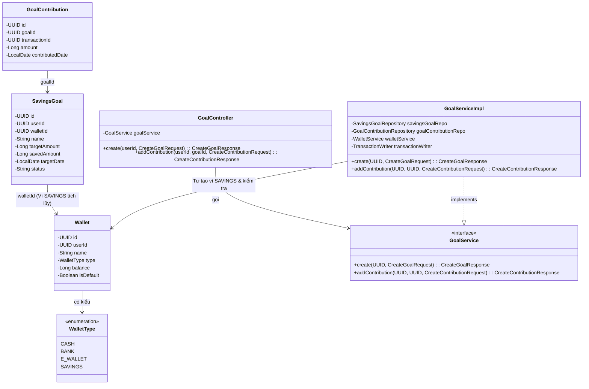
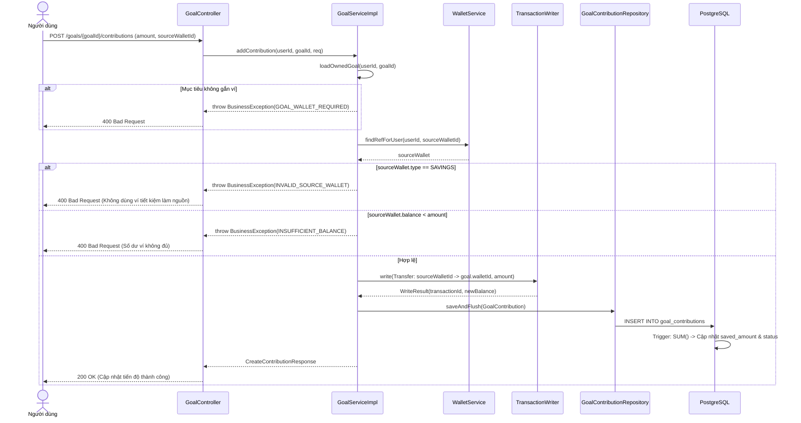

# KẾ HOẠCH & THIẾT KẾ CẢI TIẾN MODULE MỤC TIÊU TIẾT KIỆM VÀ VÍ TIẾT KIỆM (SAVINGS GOAL & WALLET)

> **Tài liệu đặc tả kiến trúc và thiết kế kỹ thuật**  
> Áp dụng mô hình chuẩn Spring Boot Layered Architecture & RESTful API.  
> Cơ sở dữ liệu: Flyway migrations tại `src/main/resources/db/migration_v2` (Phiên bản tiếp theo: `V14`)  
> Ngày cập nhật: 19/10/2026

---

## 📌 MỤC LỤC
1. [Bối cảnh & Mục tiêu Cải tiến](#1-boi-canh--muc-tieu-cai-tien)
2. [Nguyên tắc Nghiệp vụ Cốt lõi (Business Rules)](#2-nguyen-tac-nghiep-vu-cot-loi)
3. [Thiết kế Cơ sở dữ liệu (db/migration_v2)](#3-thiet-ke-co-so-du-lieu)
4. [Bước 1: Kịch bản Use Case & Thiết kế RESTful API](#buoc-1-kich-ban-use-case--thiet-ke-restful-api)
5. [Bước 2: Thiết kế Thực thể JPA (@Entity) & DTO](#buoc-2-thiet-ke-thuc-the-jpa-entity--dto)
6. [Bước 3: Thiết kế Tĩnh - Biểu đồ lớp (Class Diagram)](#buoc-3-thiet-ke-tinh---bieu-do-lop-class-diagram)
7. [Bước 4: Thiết kế Động - Biểu đồ tuần tự (Sequence Diagram)](#buoc-4-thiet-ke-dong---bieu-do-tuan-tu-sequence-diagram)
8. [Bước 5: Kịch bản Kiểm thử REST API (Test Cases)](#buoc-5-kich-ban-kiem-thu-rest-api-test-cases)
9. [Lộ trình Triển khai Chi tiết (Implementation Roadmap)](#9-lo-trinh-trien-khai-chi-tiet)

---

## 1. BỐI CẢNH & MỤC TIÊU CẢI TIẾN

### 1.1. Hiện trạng
* Hệ thống đang sử dụng cấu hình Flyway tại **`src/main/resources/db/migration_v2`** (đã có từ `V1` đến `V13__create_debt.sql`).
* Hai bảng `savings_goals` và `goal_contributions` chưa được đưa vào `migration_v2`.
* `WalletType` hiện tại có: `CASH`, `BANK`, `E_WALLET` (chưa có loại ví chuyên biệt cho tiết kiệm/tích lũy).
* Người dùng khi tạo mục tiêu tiết kiệm (`SavingsGoal`) phải tự chọn ví hoặc để trống, chưa có cơ chế tự động tách biệt ví tiền tiết kiệm với ví chi tiêu hàng ngày.

### 1.2. Mục tiêu sau cải tiến
1. **Đưa toàn bộ module Goal vào `db/migration_v2`:** Tạo script **`V14__create_savings_goals.sql`** hoàn chỉnh gồm bảng, indexes và triggers tự động đồng bộ.
2. **Phân loại rõ ràng ví tiết kiệm:** Bổ sung loại ví `SAVINGS` vào `WalletType`.
3. **Tự động sinh ví tích lũy:** Khi tạo mục tiêu chọn `manageWithWallet = true`, hệ thống tự khởi tạo một ví loại `SAVINGS` mang tên mục tiêu.
4. **Bảo vệ dòng tiền tiết kiệm:** 
   * Cấm tuyệt đối việc chọn ví `SAVINGS` để làm ví thanh toán cho các khoản chi tiêu thông thường (`type = 'EXPENSE'`).
   * Khi nạp tiền vào mục tiêu, ví nguồn không được là ví loại `SAVINGS` và phải có số dư lớn hơn hoặc bằng số tiền nạp.

---

## 2. NGUYÊN TẮC NGHIỆP VỤ CỐT LÕI (BUSINESS RULES)

* **BR-GOAL-01 (Tự động sinh ví):** Nếu request tạo mục tiêu có `manageWithWallet = true`, hệ thống tự sinh ví `Wallet` với `type = 'SAVINGS'`, `name = "[Tiết kiệm] " + goal.name`, `balance = 0`. Gán ID ví này vào `SavingsGoal.walletId`.
* **BR-GOAL-02 (Tiết kiệm ngoài app):** Nếu `manageWithWallet = false`, `SavingsGoal.walletId = null`. Tiến độ tiết kiệm được theo dõi độc lập, nạp tiền không sinh giao dịch ví.
* **BR-GOAL-03 (Bảo vệ ví tiết kiệm - Chặn chi tiêu):** Tại API tạo giao dịch tài chính (`TransactionService`), nếu giao dịch là `EXPENSE` hoặc `LOAN` mà `wallet.type == SAVINGS` thì từ chối với mã lỗi `WALLET_SAVINGS_CANNOT_SPEND` (HTTP 400).
* **BR-GOAL-04 (Hợp lệ ví nguồn khi nạp tiền):** Khi nạp tiền vào mục tiêu (`createTransaction = true`):
  * Ví nguồn (`sourceWalletId`) phải thuộc về người dùng hiện tại.
  * Ví nguồn **không được là loại `SAVINGS`** (tránh rút tiền từ quỹ tiết kiệm này nạp quỹ tiết kiệm khác).
  * Số dư ví nguồn phải: `sourceWallet.balance >= amount` (không cho phép nạp âm số dư).
* **BR-GOAL-05 (Chuyển tiền nội bộ - Transfer):** Giao dịch nạp tiền luôn mang loại `transfer` từ `sourceWalletId` sang `goal.walletId`. Giao dịch này không tính vào báo cáo chi tiêu hàng tháng.
* **BR-GOAL-06 (Đồng bộ số tiền và trạng thái qua Trigger):** Mọi thay đổi về `saved_amount` và `status` (`in_progress` <-> `completed`) của `SavingsGoal` vẫn hoàn toàn do DB Trigger `trg_goal_contributions_sync` đảm nhiệm.

---

## 3. THIẾT KẾ CƠ SỞ DỮ LIỆU (db/migration_v2)

File script mới: **`src/main/resources/db/migration_v2/V14__create_savings_goals.sql`**

```sql
-- =============================================================
-- V14: KHỐI MỤC TIÊU TIẾT KIỆM (SAVINGS GOALS & CONTRIBUTIONS)
-- VÀ BỔ SUNG RÀNG BUỘC VÍ 'SAVINGS'
-- =============================================================

-- 1. Bổ sung ràng buộc kiểm tra loại ví trong wallets
ALTER TABLE wallets DROP CONSTRAINT IF EXISTS ck_wal_type;
ALTER TABLE wallets ADD CONSTRAINT ck_wal_type 
    CHECK (type IN ('CASH', 'BANK', 'E_WALLET', 'SAVINGS'));

-- 2. Bảng savings_goals - Mục tiêu tích lũy tài chính
CREATE TABLE savings_goals (
    id            UUID         PRIMARY KEY,
    user_id       UUID         NOT NULL,
    wallet_id     UUID,
    name          VARCHAR(100) NOT NULL,
    target_amount BIGINT       NOT NULL,
    saved_amount  BIGINT       NOT NULL DEFAULT 0,
    target_date   DATE,
    icon_id       UUID,
    status        VARCHAR(20)  NOT NULL DEFAULT 'in_progress',
    created_at    TIMESTAMPTZ  NOT NULL DEFAULT now(),
    updated_at    TIMESTAMPTZ  NOT NULL DEFAULT now(),
    is_deleted    BOOLEAN      NOT NULL DEFAULT FALSE,

    CONSTRAINT fk_goal_user   FOREIGN KEY (user_id)   REFERENCES users   (id) ON DELETE CASCADE,
    CONSTRAINT fk_goal_wallet FOREIGN KEY (wallet_id) REFERENCES wallets (id) ON DELETE SET NULL,
    CONSTRAINT fk_goal_icon   FOREIGN KEY (icon_id)   REFERENCES icons   (id) ON DELETE SET NULL,
    CONSTRAINT ck_goal_target CHECK (target_amount > 0),
    CONSTRAINT ck_goal_saved  CHECK (saved_amount >= 0),
    CONSTRAINT ck_goal_status CHECK (status IN ('in_progress', 'completed', 'cancelled'))
);

CREATE INDEX idx_goals_user_status ON savings_goals (user_id, status) WHERE NOT is_deleted;

-- 3. Bảng goal_contributions - Lịch sử các lần đóng góp vào mục tiêu
CREATE TABLE goal_contributions (
    id               UUID        PRIMARY KEY,
    goal_id          UUID        NOT NULL,
    transaction_id   UUID,
    amount           BIGINT      NOT NULL,
    contributed_date DATE        NOT NULL,
    created_at       TIMESTAMPTZ NOT NULL DEFAULT now(),
    updated_at       TIMESTAMPTZ NOT NULL DEFAULT now(),
    is_deleted       BOOLEAN     NOT NULL DEFAULT FALSE,

    CONSTRAINT fk_gc_goal   FOREIGN KEY (goal_id)        REFERENCES savings_goals (id) ON DELETE CASCADE,
    CONSTRAINT fk_gc_txn    FOREIGN KEY (transaction_id) REFERENCES transactions  (id) ON DELETE SET NULL,
    CONSTRAINT ck_gc_amount CHECK (amount > 0)
);

CREATE INDEX idx_gc_goal_date ON goal_contributions (goal_id, contributed_date) WHERE NOT is_deleted;

-- 4. Triggers cập nhật updated_at
CREATE TRIGGER trg_savings_goals_updated_at
    BEFORE UPDATE ON savings_goals
    FOR EACH ROW EXECUTE FUNCTION fn_set_updated_at();

CREATE TRIGGER trg_goal_contributions_updated_at
    BEFORE UPDATE ON goal_contributions
    FOR EACH ROW EXECUTE FUNCTION fn_set_updated_at();

-- 5. Trigger tự động đồng bộ saved_amount và chuyển đổi trạng thái mục tiêu
CREATE OR REPLACE FUNCTION fn_goal_contributions_sync()
RETURNS TRIGGER AS $$
DECLARE
    v_goal_id UUID := COALESCE(NEW.goal_id, OLD.goal_id);
    v_total   BIGINT;
BEGIN
    SELECT COALESCE(SUM(amount), 0) INTO v_total
      FROM goal_contributions WHERE goal_id = v_goal_id AND NOT is_deleted;

    UPDATE savings_goals
       SET saved_amount = v_total,
           status = CASE
               WHEN status = 'cancelled'        THEN 'cancelled'
               WHEN v_total >= target_amount    THEN 'completed'
               ELSE 'in_progress'
           END
     WHERE id = v_goal_id;

    RETURN NULL;
END;
$$ LANGUAGE plpgsql;

CREATE TRIGGER trg_goal_contributions_sync
    AFTER INSERT OR UPDATE OR DELETE ON goal_contributions
    FOR EACH ROW EXECUTE FUNCTION fn_goal_contributions_sync();
```

---

## BƯỚC 1: KỊCH BẢN USE CASE & THIẾT KẾ RESTFUL API

### 1.1. UC01: Tạo mới mục tiêu tiết kiệm
* **Endpoint:** `POST /api/v1/goals`
* **Headers:** `Authorization: Bearer <JWT>`, `Content-Type: application/json`
* **Request Body:**
  ```json
  {
    "name": "Mua Laptop Gaming",
    "targetAmount": 25000000,
    "targetDate": "2026-12-31",
    "iconId": "a1b2c3d4-...",
    "initialAmount": 2000000,
    "manageWithWallet": true
  }
  ```
* **Kịch bản thành công (201 Created):**
  1. Client gửi request tạo mục tiêu với `manageWithWallet = true`.
  2. `GoalController` nhận và validate cú pháp (`@Valid`).
  3. `GoalService` kiểm tra hạn `targetDate > hiện tại`, `targetAmount > 0`.
  4. `GoalService` gọi `WalletService` tạo một ví mới:
     * `name`: `"[Tiết kiệm] Mua Laptop Gaming"`
     * `type`: `SAVINGS`
     * `balance`: 0
  5. `GoalService` lưu bản ghi `SavingsGoal` với `walletId` trỏ tới ví vừa tạo.
  6. Nếu `initialAmount > 0`: `GoalService` tạo 1 bản ghi `GoalContribution` xuất phát điểm (`transactionId = null`).
  7. Trả về `201 Created` kèm thông tin chi tiết mục tiêu và ví tiết kiệm đi kèm.

---

### 1.2. UC02: Nạp tiền vào mục tiêu tiết kiệm
* **Endpoint:** `POST /api/v1/goals/{id}/contributions`
* **Request Body:**
  ```json
  {
    "amount": 1000000,
    "contributedDate": "2026-10-19",
    "sourceWalletId": "987fcdeb-...",
    "createTransaction": true,
    "note": "Trích lương tháng 10"
  }
  ```
* **Kịch bản thành công (200 OK):**
  1. Client gửi yêu cầu nạp 1.000.000đ từ ví nguồn `sourceWalletId`.
  2. `GoalService` tải thông tin `SavingsGoal`:
     * Kiểm tra mục tiêu không ở trạng thái `cancelled` hoặc `completed`.
     * Kiểm tra `goal.walletId != null`.
  3. `GoalService` tải thông tin `sourceWallet`:
     * Kiểm tra `sourceWallet.userId == userId`.
     * Kiểm tra `sourceWallet.type != SAVINGS` (Ví nguồn không được là ví tiết kiệm).
     * Kiểm tra `sourceWallet.balance >= 1000000` (Đủ số dư).
  4. `GoalService` gọi `TransactionWriter` ghi giao dịch `transfer`:
     * `sourceWalletId` giảm 1.000.000đ.
     * `goal.walletId` tăng 1.000.000đ.
  5. `GoalService` chèn bản ghi vào `GoalContribution` và flush xuống DB.
  6. Trigger `trg_goal_contributions_sync` tự động cộng `saved_amount` và cập nhật `status = 'completed'` nếu đủ mục tiêu.
  7. Trả về `200 OK` với tiến độ mới và số dư ví nguồn sau giao dịch.

---

### 1.3. UC03: Chặn chi tiêu thông thường từ ví SAVINGS
* **Endpoint:** `POST /api/v1/transactions`
* **Request Body:**
  ```json
  {
    "walletId": "<ID_CUA_VI_SAVINGS>",
    "type": "EXPENSE",
    "amount": 50000,
    "categoryId": "<CATEGORY_ID>"
  }
  ```
* **Kịch bản ngoại lệ (400 Bad Request):**
  1. `TransactionService` kiểm tra `wallet.type == SAVINGS`.
  2. Vì `type == 'EXPENSE'`, hệ thống ném ngoại lệ `BusinessException(ErrorCode.WALLET_SAVINGS_CANNOT_SPEND)`.
  3. Phản hồi HTTP 400 kèm thông báo: *"Không thể sử dụng ví tiết kiệm làm ví thanh toán chi tiêu"*.

---

## BƯỚC 2: THIẾT KẾ THỰC THỂ JPA (@ENTITY) & DTO

### 2.1. Enum `WalletType.java`
```java
package com.datn.financeapp.module.wallet.enums;

public enum WalletType {
    CASH,       // Tiền mặt
    BANK,       // Tài khoản ngân hàng
    E_WALLET,   // Ví điện tử (MoMo, ZaloPay...)
    SAVINGS     // Ví tích lũy tiết kiệm (Heo đất, Sổ tiết kiệm)
}
```

### 2.2. DTO `CreateGoalRequest.java`
```java
package com.datn.financeapp.module.goal.dto.request;

import jakarta.validation.constraints.NotBlank;
import jakarta.validation.constraints.NotNull;
import jakarta.validation.constraints.Positive;
import jakarta.validation.constraints.Size;

import java.time.LocalDate;
import java.util.UUID;

public record CreateGoalRequest(
        @NotBlank(message = "Tên mục tiêu không được để trống.")
        @Size(min = 1, max = 100, message = "Tên mục tiêu phải từ 1 đến 100 ký tự.")
        String name,

        @NotNull(message = "Số tiền mục tiêu không được để trống.")
        @Positive(message = "Số tiền mục tiêu phải lớn hơn 0.")
        Long targetAmount,

        LocalDate targetDate,
        UUID iconId,
        Long initialAmount,

        // true = Tự động sinh một ví SAVINGS mang tên mục tiêu này
        Boolean manageWithWallet
) {
}
```

---

## BƯỚC 3: THIẾT KẾ TĨNH - BIỂU ĐỒ LỚP (CLASS DIAGRAM)



---

## BƯỚC 4: THIẾT KẾ ĐỘNG - BIỂU ĐỒ TUẦN TỰ (SEQUENCE DIAGRAM)



---

## BƯỚC 5: KỊCH BẢN KIỂM THỬ REST API (TEST CASES)

| Mã Test Case | Loại kiểm thử | Mục đích kiểm thử | Đầu vào (Input) | Điều kiện ban đầu | Kết quả kỳ vọng (Expected Output) |
| :--- | :--- | :--- | :--- | :--- | :--- |
| **TC_GOAL_01** | Tạo Goal có ví | Tạo mục tiêu kèm tự động tạo ví tiết kiệm | `manageWithWallet = true`, `name = "Mua iPad"`, `targetAmount = 15000000` | User đã xác thực | - HTTP `201 Created`<br>- Bản ghi `savings_goals` có `wallet_id != null`<br>- Bảng `wallets` có 1 ví mới `type = SAVINGS`, tên `[Tiết kiệm] Mua iPad`. |
| **TC_GOAL_02** | Tạo Goal không ví | Tạo mục tiêu ghi nhận ngoài đời thực | `manageWithWallet = false`, `name = "Nuôi heo"` | User đã xác thực | - HTTP `201 Created`<br>- `wallet_id = null`. |
| **TC_CONTRIB_01** | Luồng chuẩn nạp tiền | Nạp 1.000.000đ từ ví CASH sang ví SAVINGS | `amount = 1000000`, `sourceWalletId = CASH_ID`, `createTransaction = true` | Ví CASH có số dư 3.000.000đ | - HTTP `200 OK`<br>- Ví CASH giảm còn 2.000.000đ<br>- Ví SAVINGS tăng thêm 1.000.000đ<br>- `saved_amount` tăng 1.000.000đ. |
| **TC_CONTRIB_02** | Lỗi số dư | Nạp vượt quá số dư ví nguồn | `amount = 5000000`, `sourceWalletId = CASH_ID` | Ví CASH chỉ có 2.000.000đ | - HTTP `400 Bad Request`<br>- Message: "Số dư ví nguồn không đủ để trích tiền." |
| **TC_CONTRIB_03** | Ràng buộc loại ví | Nạp tiền lấy nguồn từ một ví SAVINGS khác | `sourceWalletId = OTHER_SAVINGS_ID` | `OTHER_SAVINGS_ID` có type = `SAVINGS` | - HTTP `400 Bad Request`<br>- Message: "Không thể sử dụng ví tiết kiệm làm ví nguồn." |
| **TC_TXN_01** | Ràng buộc chi tiêu | Dùng ví SAVINGS để thanh toán hóa đơn | `POST /transactions`<br>`walletId = SAVINGS_ID`, `type = EXPENSE` | Ví SAVINGS tồn tại | - HTTP `400 Bad Request`<br>- Message: "Ví tiết kiệm không thể sử dụng để chi tiêu trực tiếp." |

---

## 9. LỘ TRÌNH TRIỂN KHAI CHI TIẾT

```text
[Giai đoạn 1] Database Migration: Viết V14__create_savings_goals.sql trong db/migration_v2
      │
      ▼
[Giai đoạn 2] Cập nhật Enum WalletType.SAVINGS & ErrorCode
      │
      ▼
[Giai đoạn 3] Nâng cấp CreateGoalRequest & GoalServiceImpl.create (Tự sinh ví SAVINGS)
      │
      ▼
[Giai đoạn 4] Nâng cấp GoalServiceImpl.addContribution (Kiểm tra ví nguồn & số dư)
      │
      ▼
[Giai đoạn 5] Bổ sung validation chặn ví SAVINGS chi tiêu trong module Transaction
      │
      ▼
[Giai đoạn 6] Viết Test Cases kiểm thử toàn bộ luồng
```
